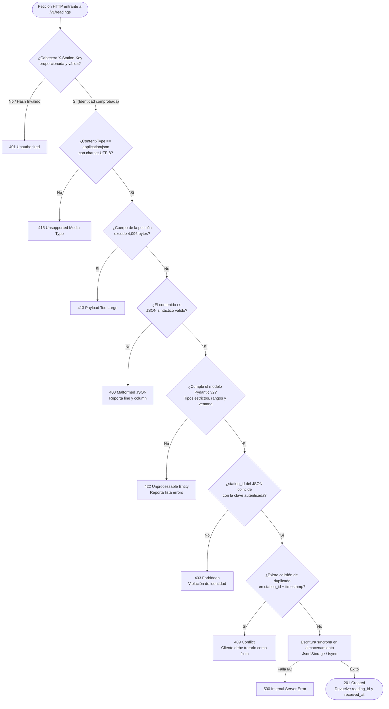

# Manual de Conexión Técnica v1.0
## Plataforma Federada de Telemetría Meteorológica — SKILIKET (Equipo 7)

---

### Control del Documento

| Campo | Detalle Técnico |
| :--- | :--- |
| **Proyecto** | SKILIKET — Plataforma Federada de Estaciones Meteorológicas |
| **Documento** | Manual de Conexión Técnica e Integración de Nodos Federados |
| **Versión del Contrato** | 1.0 (`SCHEMA_VERSION = "1.0"`) |
| **Versión de Firmware de Referencia** | `sim-0.1.0` |
| **Destino de Infraestructura en Nube** | Microsoft Azure (Azure Container Apps / Azure Blob Storage) |
| **Entorno de Simulación Local** | Python 3.13 / Uvicorn ASGI / Contenedores Docker |
| **Especificación de Errores** | RFC 9457 (`application/problem+json`) |

---

## 1. Introducción y Arquitectura de Integración

### 1.1 Modelo de Integración Federada
La plataforma **SKILIKET** implementa un modelo de integración federada para la recolección, validación rigurosa y centralización de telemetría meteorológica superficial generada por instituciones educativas externas. Bajo esta arquitectura, cada institución actúa como un **nodo federado autónomo**, responsable de operar sus propios instrumentos de medición en sitio o emuladores de telemetría, conservando la soberanía de sus estaciones y respetando un contrato estricto de comunicación síncrona.

```
       [ NODO FEDERADO EXTERNO ]
  (Estación Meteorológica / Simulación)
                   │
                   │  1. Lectura de Sensores / Síntesis Física
                   ▼
       [ Cliente HTTP de Telemetría ]
                   │
                   │  2. Serialización JSON v1 estricto
                   │  3. Inyección de Cabecera X-Station-Key
                   ▼
  ───────────────── HTTPS POST /v1/readings ─────────────────
                   │
                   ▼
     [ Microsoft Azure / Container Apps Ingress ]
                   │
                   ▼
           [ API de Ingesta ]
  (FastAPI 0.142+ / Pydantic v2 / Python 3.13)
     ├─ Autenticación: Timing-Safe Hash Matching
     ├─ Inspección de Cuota: Límite estricto de 4,096 bytes
     ├─ Validación de Esquema: Strict Pydantic Models
     └─ Deduplicación: (station_id, timestamp)
                   │
                   ▼
      [ Persistencia Síncrona ]
   Local: JsonlStorage (readings.jsonl con fsync)
   Nube:  Azure Blob Storage Adapter (Append Blob)
```

La comunicación entre los nodos federados y el concentrador central se efectúa exclusivamente mediante el protocolo de transporte de capa de aplicación **HTTP/REST** sobre canales seguros TLS (HTTPS en el entorno productivo de Microsoft Azure y HTTP plano en pruebas de entorno local). La carga útil se transmite codificada en formato **JSON estándar bajo codificación estricta UTF-8**.

El núcleo del sistema centralizador es el componente **Ingest API**, diseñado con base en el marco de trabajo **FastAPI** y el motor de validación en tiempo de ejecución **Pydantic v2**. El servicio procesa individualmente las lecturas meteorológicas, aplicando una política de tolerancia cero a la ambigüedad tipológica (coerción estricta deshabilitada). Esto garantiza que únicamente mediciones físicamente verosímiles, sintácticamente impecables y criptográficamente autenticadas sean admitidas en el almacenamiento persistente.

### 1.2 Emulación de Hardware y Concurrencia Mediante Contenedores
Para validar el comportamiento del concentrador frente a múltiples nodos enviando telemetría concurrente antes de realizar el despliegue final sobre microcontroladores físicos (como ESP32 o Raspberry Pi con sensores I2C/SPI), la plataforma utiliza un subsistema de emulación sintética basado en procesos aislados. 

El hardware de la estación meteorológica se simula matemáticamente mediante un modelo estocástico continuo implementado en el paquete `station.station.weather_model`. Este modelo aproxima las condiciones climatológicas reales del Valle de Atemajac (Guadalajara, México: latitud `20.67° N`, longitud `-103.35° W`, elevación `1,550 msnm`):

*   **Temperatura y Dinámica Solar:** Modela la radiación solar global horizontal mediante la ley exponencial de atenuación atmosférica y el cálculo astronómico exacto de elevación solar (`solar.py`). La temperatura sigue un ciclo diurno asimétrico combinado con procesos autorregresivos de primer orden **AR(1)**:
    $$\phi = \exp\left(-\frac{\Delta t}{\tau}\right)$$
    donde el ruido se escala exactamente con $\sigma \sqrt{1 - \phi^2}$ para mantener la varianza invariante ante cualquier intervalo de integración $\Delta t$.
*   **Humedad Relativa:** Calculada matemáticamente mediante la ecuación psicrométrica de **Magnus-Tetens** (coeficientes de Alduchov y Eskridge, 1996: $A = 17.625$, $B = 243.04\text{ }^\circ\text{C}$):
    $$\text{RH} = 100 \times \exp\left(\frac{A \cdot T_{\text{dew}}}{B + T_{\text{dew}}} - \frac{A \cdot T}{B + T}\right)$$
*   **Presión Atmosférica Estacionaria:** Evaluada conforme a la fórmula barométrica de la Atmósfera Estándar Internacional (ISA):
    $$P_{\text{base}} = 1013.25 \times \left(1 - 2.25577 \times 10^{-5} \cdot h\right)^{5.25588}\text{ hPa}$$
    acoplada a oscilaciones semidiurnas por marea barométrica térmica atmosférica con crestas en las 10:00 y 22:00 horas locales.
*   **Régimen Eólico:** Distribución de **Weibull** con factor de forma $k = 2$ para la velocidad media, y modelado de ráfagas basado en distribuciones logarítmicas del intervalo de integración temporal.

La ejecución simultánea de múltiples instancias emuladoras mediante **Docker** permite reproducir de manera fidedigna la contención de recursos, la concurrencia de peticiones HTTP en el loop asíncrono de eventos de Uvicorn, y verificar la integridad de la deduplicación transaccional sobre el backend de persistencia.

---

## 2. Requisitos Previos y Preparación del Entorno

### 2.1 Requisitos del Cliente Externo para la Integración
Cualquier estación física o cliente de software operado por una institución federada que pretenda inyectar telemetría a la red SKILIKET debe satisfacer los siguientes requerimientos técnicos de capa de aplicación:

1.  **Soporte de Transporte HTTP 1.1 / TLS:** Capacidad para establecer conexiones TCP/IP con negociación de cifrado TLS v1.2 o superior en destino productivo.
2.  **Codificación Estricta:** El cliente debe serializar las estructuras de datos únicamente en cadenas de bytes codificadas bajo **UTF-8**. Se rechaza tajantemente el uso de terminaciones o variantes regionales como ISO-8859-1 o Windows-1252.
3.  **Cabeceras Obligatorias:** Toda petición hacia el concentrador debe incluir inalterablemente:
    *   `Host: <dominio-o-ip>`
    *   `Content-Type: application/json; charset=utf-8` (o simplemente `application/json`)
    *   `Content-Length: <longitud-en-bytes>` (el servidor acepta envíos segmentados *chunked transfer encoding*, pero no permite que la carga supere los 4,096 bytes).
    *   `X-Station-Key: <token-criptografico-alfanumerico>`
4.  **Manejo de Respuestas RFC 9457:** Los clientes deben implementar un analizador de tipos de contenido capaz de procesar respuestas de error con cabecera `Content-Type: application/problem+json`.

### 2.2 Dependencias del Ecosistema de Referencia
Para compilar y ejecutar las herramientas de verificación local y las estaciones simuladas provistas en el repositorio, la estación de trabajo debe contar con:
*   **Python:** Versión estricta **3.13** (requerida por las optimizaciones del runtime y tipado de Pydantic v2).
*   **Gestor de paquetes:** `pip` actualizado a la versión más reciente.
*   **Motor de Contenedores:** Docker Engine versión 24.0+ y Docker Compose v2.20+.

### 2.3 Especificación de Arquitectura de Red y Servicios Docker Compose
Para simular el ecosistema federado localmente, se define una topología de red virtualizada utilizando Docker Compose. La configuración segrega la capa de ingesta centralizada de los contenedores clientes que emulan las estaciones institucionales:

```yaml
version: "3.8"

networks:
  skiliket-federation-net:
    driver: bridge
    ipam:
      config:
        - subnet: 172.28.0.0/16

services:
  ingest-api:
    build:
      context: .
      dockerfile: ingest_api/Dockerfile
    container_name: skiliket-ingest-api
    restart: unless-stopped
    networks:
      skiliket-federation-net:
        ipv4_address: 172.28.0.10
    ports:
      - "8000:8000"
    environment:
      - STATION_KEY_HASHES={"GDL-001":["b6483fb58c89b27521e1141df90e3eb4c02f83733b8a1c6a27e7f77626955a13"],"PUE-002":["2c26b46b68ffc68ff99b453c1d30413413422d706483bfa0f98a5e886266e7ae"]}
      - STORAGE_PATH=/app/data/readings.jsonl
      - MAX_FUTURE_SKEW_S=300
      - MAX_PAST_AGE_S=604800
    volumes:
      - ingest-storage-data:/app/data

  station-gdl-001:
    build:
      context: .
      dockerfile: station/Dockerfile
    container_name: skiliket-station-gdl001
    depends_on:
      - ingest-api
    networks:
      - skiliket-federation-net
    environment:
      - STATION_ID=GDL-001
      - STATION_KEY=vX9_example_token_32bytes_random_secret_gdl
      - INGEST_URL=http://ingest-api:8000/v1/readings
      - INTERVAL_S=60
      - LAT=20.67
      - LON=-103.35
      - ELEVATION_M=1550.0
      - FAULT_RATE=0.0

volumes:
  ingest-storage-data:
    driver: local
```

#### Desglose Técnico de la Red y Contenedores:
*   **Red `skiliket-federation-net`:** Un puente (*bridge network*) aislado con direccionamiento estático en el bloque `172.28.0.0/16`. Garantiza resolución DNS interna por nombre de servicio.
*   **Servicio `ingest-api`:**
    *   Expone el puerto `8000` del host mapeado al puerto `8000` del contenedor.
    *   Monta el volumen persistente `ingest-storage-data` en la ruta `/app/data`, aislando el archivo `readings.jsonl` del ciclo de vida del contenedor.
    *   Declara la variable `STATION_KEY_HASHES` en memoria, asegurando que las llaves nunca residan en disco.
*   **Servicio `station-gdl-001`:**
    *   Contenedor cliente que sintetiza hardware. Se comunica internamente a través de la URL de resolución DNS privada `http://ingest-api:8000/v1/readings`.
    *   Consume la variable `STATION_KEY` en claro, aislada en el espacio de usuario del contenedor del nodo emulado.

---

## 3. Guía Rápida de Inicio (Quick Start)

Siga escrupulosamente los siguientes cinco pasos técnicos para desplegar el entorno de desarrollo local, generar credenciales y emitir la primera transacción de telemetría.

### Paso 1: Inicialización del Entorno Virtual de Python y Dependencias
Desde la terminal PowerShell o Bash en la raíz del repositorio, cree y active un entorno virtual aislado utilizando Python 3.13:

```powershell
# Verificación de versión del intérprete
py -3.13 --version
# Salida esperada: Python 3.13.x

# Creación del entorno virtual
py -3.13 -m venv .venv

# Activación del entorno virtual en Windows PowerShell
.\.venv\Scripts\Activate.ps1

# Instalación de dependencias de desarrollo del API y de la estación
pip install --upgrade pip
pip install -r ingest_api\requirements-dev.txt
pip install -r station\requirements.txt
```

Salida esperada en terminal:
```text
Successfully installed fastapi-0.142.2 uvicorn-0.34.0 pydantic-2.10.6 starlette-0.45.3 pytest-8.3.4 ...
```

### Paso 2: Generación Criptográfica de la Clave de Estación
Ejecute el script utilitario oficial `scripts/gen_station_key.py`. Este módulo utiliza el generador de entropía del sistema operativo (`secrets.token_urlsafe(32)`) para producir una llave simétrica y derivar su resumen criptográfico SHA-256:

```powershell
python scripts\gen_station_key.py
```

Salida esperada:
```text
STATION_KEY=k8ZJ-2tU7e4kH3a9WqL1pMn0BvCxYz8A7dEfGhIjKlM
SHA256=a5b6c891e4f20384729104856123456789abcdef0123456789abcdef01234567
Copia la clave ahora: no se vuelve a mostrar ni se guarda.
```

> **Regla de Operación:** La cadena `STATION_KEY` se entrega al administrador de la estación meteorológica externa. La cadena `SHA256` se provisiona en la configuración del servidor central.

### Paso 3: Configuración de Variables de Entorno y Levantamiento del API
Configure las variables del sistema para registrar el hash generado para el identificador de estación `GDL-001` y arranque el servidor ASGI Uvicorn utilizando el patrón *factory*:

```powershell
# Registro del hash en la variable de entorno de sesión
$env:STATION_KEY_HASHES = '{"GDL-001": ["a5b6c891e4f20384729104856123456789abcdef0123456789abcdef01234567"]}'
$env:STORAGE_PATH = "./data/readings.jsonl"

# Ejecución del servidor ASGI en el puerto 8000
python -m uvicorn app.main:create_app --app-dir ingest_api --factory --host 127.0.0.1 --port 8000 --log-level info
```

Salida esperada del servidor:
```text
INFO:     Started server process [18920]
INFO:     Waiting for application startup.
INFO:     Application startup complete.
INFO:     Uvicorn running on http://127.0.0.1:8000 (Press CTRL+C to quit)
```

### Paso 4: Transmisión Manual de una Lectura Válida (cURL)
Desde una segunda consola de comandos, construya una petición HTTP POST manual inyectando la cabecera `X-Station-Key` con la clave obtenida en el Paso 2:

```bash
curl -X POST "http://127.0.0.1:8000/v1/readings" \
  -H "Content-Type: application/json" \
  -H "X-Station-Key: k8ZJ-2tU7e4kH3a9WqL1pMn0BvCxYz8A7dEfGhIjKlM" \
  -d '{
    "schema_version": "1.0",
    "station_id": "GDL-001",
    "timestamp": "2026-10-01T21:15:00Z",
    "sequence": 1,
    "interval_s": 60,
    "measurements": {
      "air_temperature_c": 24.5,
      "relative_humidity_pct": 55,
      "station_pressure_hpa": 842.1,
      "wind_speed_ms": 3.2,
      "wind_gust_ms": 4.8,
      "wind_direction_deg": 250,
      "precipitation_mm": 0.0,
      "solar_radiation_wm2": 620
    },
    "device": {
      "battery_v": 12.85,
      "firmware": "sim-0.1.0"
    }
  }' -v
```

Salida esperada de cabeceras y cuerpo (HTTP/1.1 201 Created):
```http
< HTTP/1.1 201 Created
< content-length: 125
< content-type: application/json
< 
{"status":"created","reading_id":"b3e85e2b-2d7c-47bc-8ef6-15ec4c7aa01f","station_id":"GDL-001","received_at":"2026-10-01T21:15:02.104231Z"}
```

En la consola del servidor se registrará la traza estructurada:
```json
{"event": "reading", "status": 201, "reason": "created", "station_id": "GDL-001", "reading_id": "b3e85e2b-2d7c-47bc-8ef6-15ec4c7aa01f"}
```

### Paso 5: Verificación de Persistencia Física en Disco
Compruebe que la lectura fue serializada en el formato append-only del motor local:

```powershell
Get-Content -Path .\data\readings.jsonl -Tail 1
```

Salida esperada:
```json
{"reading_id": "b3e85e2b-2d7c-47bc-8ef6-15ec4c7aa01f", "received_at": "2026-10-01T21:15:02.104231Z", "reading": {"schema_version": "1.0", "station_id": "GDL-001", "timestamp": "2026-10-01T21:15:00Z", "sequence": 1, "interval_s": 60, "measurements": {"air_temperature_c": 24.5, "relative_humidity_pct": 55, "station_pressure_hpa": 842.1, "wind_speed_ms": 3.2, "wind_gust_ms": 4.8, "wind_direction_deg": 250, "precipitation_mm": 0.0, "solar_radiation_wm2": 620}, "device": {"battery_v": 12.85, "firmware": "sim-0.1.0"}}}
```

---

## 4. Autenticación y Seguridad

### 4.1 Mecanismo de Identificación por Clave de Estación (`X-Station-Key`)
La seguridad del perímetro de ingesta descansa sobre un modelo de clave simétrica precompartida transportada a nivel de cabecera HTTP. No se utilizan credenciales en la URL, parámetros de consulta (*query params*) ni dentro del cuerpo JSON.

*   **Nombre exacto de la cabecera:** `X-Station-Key`
*   **Especificación de la clave:** Cadena que debe cumplir estrictamente con la expresión regular:
    $$\wedge[\backslash x21-\backslash x7e]\{16,256\}\$$$
    Esto restringe la clave a caracteres ASCII visibles sin espacios en blanco, con una longitud de entre 16 y 256 caracteres. Las claves generadas por el sistema (`scripts/gen_station_key.py`) tienen una entropía de 256 bits codificados en 43 caracteres urlsafe.

### 4.2 Arquitectura del Interceptor y Verificación Resistente a Ataques de Temporización
El backend no almacena jamás la clave en texto claro. La clase `app.auth.KeyVerifier` implementa un procedimiento de autenticación con las siguientes propiedades de seguridad:

1.  **Cálculo Inmediato de Resumen:** Cuando una petición arriba, el valor recibido en la cabecera `X-Station-Key` es procesado mediante SHA-256 en hexadecimal en minúsculas:
    ```python
    def hash_key(key: str) -> str:
        return hashlib.sha256(key.encode("utf-8")).hexdigest()
    ```
2.  **Mitigación de Ataques de Canal Lateral por Temporización (*Timing Attacks*):**
    El código implementado en `KeyVerifier.station_for_key` recorre deliberadamente **todas** las tuplas `(station_id, digest)` registradas en el sistema utilizando `hmac.compare_digest`, **sin interrumpir el ciclo (*early exit*) al encontrar una coincidencia**:

    ```python
    def station_for_key(self, key: str | None) -> str | None:
        if not key:
            return None
        candidate = hash_key(key).encode("ascii")
        match = None
        # Se recorren todas las entradas (sin salir antes) para no filtrar
        # por tiempo de respuesta qué estación o posición coincidió.
        for station_id, digest in self._entries:
            if hmac.compare_digest(candidate, digest):
                match = station_id
        return match
    ```
    Esta decisión de diseño impide que un atacante determine la existencia de claves válidas o la posición de un hash en la tabla interna mediante análisis estadístico de la latencia de respuesta HTTP.

### 4.3 Configuración de Múltiples Claves y Rotación sin Pérdida de Servicio
El diccionario de configuración `STATION_KEY_HASHES` permite vincular de **1 a 2 hashes SHA-256** por cada identificador de estación (`station_id`). Esta restricción permite el siguiente protocolo de rotación de credenciales en producción:

1.  La estación opera con la Clave A. El servidor tiene registrado: `{"GDL-001": ["<hash_A>"]}`.
2.  El administrador genera la Clave B y añade su hash a la configuración del concentrador: `{"GDL-001": ["<hash_A>", "<hash_B>"]}`.
3.  La estación física o nodo simulado actualiza su entorno local a la Clave B y comienza a transmitir. Durante la transición, peticiones con Clave A o Clave B son admitidas.
4.  Una vez confirmado el flujo estable con la Clave B, se elimina el `<hash_A>` del servidor.
5.  **Aislamiento Estricto:** Está prohibido que un mismo hash esté asignado a más de una estación. Si el servidor detecta colisión durante el arranque en `parse_station_key_hashes()`, se aborta el inicio del proceso mediante un error fatal `ConfigError`.

### 4.4 Matriz de Políticas de Rechazo y Autorización

| Condición de la Petición | Código HTTP | Tipo de Problema (RFC 9457 `type`) | Causa y Comportamiento |
| :--- | :--- | :--- | :--- |
| Ausencia total de cabecera `X-Station-Key` o valor vacío. | **401 Unauthorized** | `urn:skilliket:problem:unauthorized` | La cabecera requerida no fue remitida por el cliente. |
| Clave con hash no registrado en `STATION_KEY_HASHES`. | **401 Unauthorized** | `urn:skilliket:problem:unauthorized` | La clave no existe o fue revocada. No se especifica la causa para evitar enumeración. |
| Clave válida asociada a la estación `GDL-001`, pero el cuerpo JSON contiene `"station_id": "PUE-002"`. | **403 Forbidden** | `urn:skilliket:problem:forbidden` | Violación de identidad. La credencial es válida pero no tiene privilegios para publicar telemetría de un identificador ajeno. |

---

## 5. Referencia Técnica de la API

### 5.1 Especificación del Endpoint de Ingesta

*   **Ruta:** `/v1/readings`
*   **Método HTTP:** `POST`
*   **Esquema de Seguridad:** Requiere cabecera `X-Station-Key`
*   **Tipos de Medios Aceptados:** Estrictamente `application/json` (o `application/json; charset=utf-8`). Cualquier otro parámetro de medio provoca rechazo inmediato con código **415 Unsupported Media Type**.
*   **Límite de Carga Útil:** **4,096 bytes** (`MAX_BODY_BYTES = 4096`). El servidor consume el flujo HTTP mediante chunks con acumulador. Si la suma de bytes recibidos supera este límite, la conexión se trunca y se devuelve **413 Payload Too Large**, impidiendo ataques de agotamiento de memoria por búfer (*denial-of-service*).

### 5.2 Estructura y Validación Detallada del Esquema de Datos v1
El esquema de datos está completamente tipado en Pydantic bajo la configuración:
```python
model_config = ConfigDict(extra="forbid", strict=True, allow_inf_nan=False)
```
Esto impone tres garantías deterministas:
1.  `extra="forbid"`: Prohíbe cualquier campo que no esté explícitamente documentado en la especificación. Si el cliente envía atributos no reconocidos (por ejemplo, `"dew_point_c"`), la petición es rechazada con código 422.
2.  `strict=True`: Desactiva la coerción automática de tipos. La cadena de texto `"24.5"` enviada en un campo de punto flotante **no** será convertida a float; el valor booleano `true` en un campo numérico **no** será interpretado como `1`; y un flotante `60.0` enviado en un campo tipado como entero generará un error de validación inmediato.
3.  `allow_inf_nan=False`: Rechaza tajantemente valores de punto flotante no normalizados como `NaN`, `Infinity` o `-Infinity`.

#### Tabla Detallada de Parámetros del Payload JSON

| Campo | Ubicación | Tipo de Dato | Presencia | Restricciones y Reglas de Validación de Código |
| :--- | :--- | :--- | :--- | :--- |
| `schema_version` | Raíz | `string` | **Obligatorio** | Valor constante estricto: `"1.0"`. |
| `station_id` | Raíz | `string` | **Obligatorio** | Expresión regular: `^[A-Z]{3}-[0-9]{3}$`. 3 mayúsculas ASCII, guion medio y 3 dígitos (Ej. `GDL-001`). Debe coincidir con la identidad ligada a la API Key. |
| `timestamp` | Raíz | `string` (RFC 3339) | **Obligatorio** | Patrón: `^[0-9]{4}-[0-9]{2}-[0-9]{2}T[0-9]{2}:[0-9]{2}:[0-9]{2}(\.[0-9]{1,6})?Z$`. Obligatorio sufijo literal **`Z`** (UTC). Restricción de ventana temporal: $\le 300\text{ s}$ en el futuro (`MAX_FUTURE_SKEW_S`), $\le 604,800\text{ s}$ (7 días) en el pasado (`MAX_PAST_AGE_S`). |
| `sequence` | Raíz | `integer` \| `null` | Opcional | Valor entero $\ge 0$. Permite al concentrador detectar pérdidas o huecos de paquetes en el transporte. |
| `interval_s` | Raíz | `integer` | **Obligatorio** | Duración del periodo de integración en segundos. Rango: $[10, 3600]$. Entero estricto. |
| `measurements` | Raíz | `object` | **Obligatorio** | Objeto anidado que encapsula las lecturas meteorológicas superficiales. |
| `measurements.air_temperature_c` | measurements | `number` (float) | **Obligatorio** | Temperatura del aire en grados Celsius. Rango estricto: $[-40.0, 60.0]$. |
| `measurements.relative_humidity_pct`| measurements | `number` (float) | **Obligatorio** | Humedad relativa del aire. Rango estricto: $[0.0, 100.0]$. |
| `measurements.station_pressure_hpa` | measurements | `number` (float) | **Obligatorio** | Presión barométrica absoluta a la cota del sensor en hectopascales. Rango estricto: $[500.0, 1100.0]$. |
| `measurements.wind_speed_ms` | measurements | `number` (float) | **Obligatorio** | Velocidad horizontal media del viento en metros por segundo. Rango: $[0.0, 75.0]$. |
| `measurements.wind_gust_ms` | measurements | `number` \| `null` | Opcional | Velocidad máxima instantánea de ráfaga durante el intervalo en m/s. Rango: $[0.0, 100.0]$. **Regla Relacional Inter-campo:** Si se provee, debe cumplirse obligatoriamente que $\text{wind\_gust\_ms} \ge \text{wind\_speed\_ms}$. |
| `measurements.wind_direction_deg` | measurements | `integer` \| `null`| Opcional | Dirección de procedencia del viento en grados azimutales geográficos. Rango: $[0, 359]$. Admite `null` en condiciones de calma anemométrica ($\text{wind\_speed\_ms} < 0.5\text{ m/s}$). |
| `measurements.precipitation_mm` | measurements | `number` (float) | **Obligatorio** | Precipitación líquida acumulada en el intervalo en milímetros. Rango estricto: $[0.0, 200.0]$. Mínimo incremento físico recomendado: $0.2\text{ mm}$ (paso de balancín). |
| `measurements.solar_radiation_wm2` | measurements | `number` \| `null` | Opcional | Irradiancia solar global horizontal incidente en $\text{W/m}^2$. Rango: $[0.0, 1500.0]$. |
| `device` | Raíz | `object` \| `null` | Opcional | Bloque de estado diagnóstico del hardware de la estación. |
| `device.battery_v` | device | `number` \| `null` | Opcional | Tensión de alimentación o batería en voltios. Rango: $[0.0, 15.0]$. |
| `device.firmware` | device | `string` \| `null` | Opcional | Identificador de compilación del microcódigo. Longitud: entre 1 y 64 caracteres. |

### 5.3 Payloads de Ejemplo

#### Ejemplo 1: Transmisión Completa Diurna (Con Viento y Radiación Solar)
```json
{
  "schema_version": "1.0",
  "station_id": "GDL-001",
  "timestamp": "2026-10-01T20:30:00Z",
  "sequence": 1420,
  "interval_s": 60,
  "measurements": {
    "air_temperature_c": 28.4,
    "relative_humidity_pct": 42.0,
    "station_pressure_hpa": 841.5,
    "wind_speed_ms": 4.1,
    "wind_gust_ms": 6.8,
    "wind_direction_deg": 248,
    "precipitation_mm": 0.0,
    "solar_radiation_wm2": 890.0
  },
  "device": {
    "battery_v": 13.62,
    "firmware": "sim-0.1.0"
  }
}
```

#### Ejemplo 2: Transmisión Mínima Nocturna en Calma Anemométrica (Sin Bloque Device)
Nótese la ausencia de campos opcionales (`sequence`, `device`), el uso de `null` en la dirección del viento debido a velocidad cero, y la omisión de radiación solar:
```json
{
  "schema_version": "1.0",
  "station_id": "GDL-001",
  "timestamp": "2026-10-01T04:00:00Z",
  "interval_s": 300,
  "measurements": {
    "air_temperature_c": 14.2,
    "relative_humidity_pct": 88.0,
    "station_pressure_hpa": 844.2,
    "wind_speed_ms": 0.2,
    "wind_gust_ms": null,
    "wind_direction_deg": null,
    "precipitation_mm": 0.0,
    "solar_radiation_wm2": null
  }
}
```

#### Nota Técnica Sobre Transmisión en Lotes (*Batching*)
La versión actual del contrato (`schema_version: "1.0"`) **no implementa ingesta por lotes (*batch*) en un único array JSON**. Toda petición debe consistir estrictamente en un único objeto `WeatherReading`. 

En caso de reconexión tras una falla del enlace de red, las estaciones que hayan almacenado telemetría en búfer local (`buffer_max`) deben vaciar su cola enviando **una petición HTTP individual por cada intervalo acumulado**, respetando el orden secuencial cronológico y controlando la latencia de red.

---

## 6. Manejo de Errores y Troubleshooting

Todas las respuestas de error emitidas por el concentrador se apegan estrictamente al estándar **RFC 9457** utilizando la cabecera `Content-Type: application/problem+json`. La estructura base de una respuesta de error consta de:
*   `type`: Identificador uniforme de recursos (URI/URN) que describe la clase del problema.
*   `title`: Resumen corto y legible del error.
*   `status`: Código de estado HTTP reflejado.
*   `detail`: Explicación detallada del motivo del fallo en lenguaje natural.
*   `instance`: Recurso o ruta de acceso donde se suscitó el evento (p. ej. `/v1/readings`).
*   Campos complementarios específicos (`line`, `column`, `errors`).

### 6.1 Catálogo de Códigos de Respuesta HTTP

#### HTTP 201 Created — Éxito de Ingesta y Persistencia
La lectura pasó todas las validaciones de tipo, límites físicos, congruencia temporal y deduplicación. Se garantizó la escritura física en el medio de almacenamiento mediante sincronización síncrona en disco (`fsync`).

*   **Cabecera:** `Content-Type: application/json`
*   **Cuerpo:**
    ```json
    {
      "status": "created",
      "reading_id": "8f3e2b10-6c9a-4c22-b6f7-33e14d23a789",
      "station_id": "GDL-001",
      "received_at": "2026-10-01T21:15:02.104231Z"
    }
    ```

#### HTTP 400 Bad Request — JSON Mal Formado o Constante Inválida
Ocurre si el analizador sintáctico no puede interpretar la cadena de bytes como un árbol JSON válido. El servidor procesa el cuerpo manualmente reportando la posición exacta del error sintáctico:

*   **Cabecera:** `Content-Type: application/problem+json`
*   **Cuerpo:**
    ```json
    {
      "type": "urn:skilliket:problem:malformed-json",
      "title": "Malformed JSON",
      "status": 400,
      "detail": "Expecting ',' delimiter: line 12 column 5 (char 312)",
      "instance": "/v1/readings",
      "line": 12,
      "column": 5
    }
    ```

#### HTTP 401 Unauthorized — Fallo de Autenticación
Indica la ausencia de la cabecera `X-Station-Key` o la remisión de una clave cuyo hash SHA-256 no está registrado en el concentrador.

*   **Cuerpo:**
    ```json
    {
      "type": "urn:skilliket:problem:unauthorized",
      "title": "Unauthorized",
      "status": 401,
      "detail": "Falta X-Station-Key o no es válida",
      "instance": "/v1/readings"
    }
    ```
*   **Acciones de Mitigación:**
    1. Compruebe la sintaxis del cliente HTTP asegurando que la cabecera sea `X-Station-Key` y no `Authorization` o `api-key`.
    2. Ejecute localmente `echo -n "<SU_KEY>" | sha256sum` y verifique que el hash resultante esté declarado en `STATION_KEY_HASHES` en el concentrador.

#### HTTP 403 Forbidden — Discrepancia de Identidad (*Station Mismatch*)
La credencial es criptográficamente válida, pero el campo `station_id` en el cuerpo JSON pertenece a otra entidad.

*   **Cuerpo:**
    ```json
    {
      "type": "urn:skilliket:problem:forbidden",
      "title": "Forbidden",
      "status": 403,
      "detail": "La clave no corresponde al station_id del cuerpo",
      "instance": "/v1/readings"
    }
    ```

#### HTTP 409 Conflict — Lectura Duplicada
El sistema detectó una colisión exacta sobre la tupla `(station_id, timestamp)`. El índice de deduplicación en memoria del API evita almacenar dos veces el mismo instante de tiempo de una estación.

*   **Cuerpo:**
    ```json
    {
      "type": "urn:skilliket:problem:duplicate-reading",
      "title": "Conflict",
      "status": 409,
      "detail": "Ya existe una lectura con este station_id y timestamp; al reintentar, trátalo como éxito",
      "instance": "/v1/readings"
    }
    ```
*   **Regla de Negocio Crítica para Nodos Federados:**
    Si la estación emitió una lectura, ocurrió una interrupción de red antes de recibir la confirmación HTTP 201 y la estación reintenta el envío, el concentrador responderá con **HTTP 409**. La estación cliente **debe tratar el código 409 formalmente como un éxito de transmisión**, descartar la lectura de su cola local de reintentos y proceder con la siguiente medición sin alarmar al operador.

#### HTTP 413 Payload Too Large — Cuerpo Excesivo
El cuerpo supera los 4,096 bytes permitidos (`MAX_BODY_BYTES`).

*   **Cuerpo:**
    ```json
    {
      "type": "urn:skilliket:problem:payload-too-large",
      "title": "Payload Too Large",
      "status": 413,
      "detail": "El cuerpo supera 4096 bytes",
      "instance": "/v1/readings"
    }
    ```

#### HTTP 415 Unsupported Media Type — Cabecera de Medio Inválida
El cliente envió un `Content-Type` distinto de `application/json` o utilizó una codificación diferente a UTF-8.

*   **Cuerpo:**
    ```json
    {
      "type": "urn:skilliket:problem:unsupported-media-type",
      "title": "Unsupported Media Type",
      "status": 415,
      "detail": "Content-Type debe ser application/json (UTF-8)",
      "instance": "/v1/readings"
    }
    ```

### 6.2 HTTP 422 Unprocessable Entity e Inyección de Fallas
El error **422 Unprocessable Entity** se emite cuando la carga útil es sintácticamente válida como JSON, pero **viola las reglas semánticas, de tipado, de límites físicos o relacionales del modelo Pydantic v2**.

El cuerpo de respuesta incluye una lista estructurada bajo la clave `errors`, donde cada elemento expone:
*   `field`: Ruta canónica del atributo que falló (notación de puntos).
*   `code`: Identificador unívoco del tipo de violación según Pydantic.
*   `message`: Descripción técnica de la restricción infringida.
*   `value`: Valor recibido que provocó la falla (truncado por seguridad a 100 caracteres).

#### Simulación Mediante Rutinas de Inyección de Fallas
El simulador de referencia implementa en `station.station.config` el parámetro `FAULT_RATE` (tasa de inyección de errores estocásticos entre `0.0` y `1.0`). Cuando esta opción se activa, el generador corrompe intencionalmente lecturas válidas antes de su emisión para verificar la capacidad del API de rechazar datos anómalos:

1.  **Corrupción de Tipos (*Strict Type Failure*):** Envío de cadenas numéricas en campos flotantes (`"air_temperature_c": "25.4"`), lo que detona un error de tipo `float_type`.
2.  **Inyección de Campos Prohibidos:** Inserción del atributo `"dew_point_c": 12.0` (calculado internamente en el modelo pero vetado en el contrato de API). Provoca el error `extra_forbidden`.
3.  **Violación de Límites Físicos:** Generación de lecturas fuera de rango (p. ej., `relative_humidity_pct = 105.0` o `air_temperature_c = -45.0`), disparando errores de rango `greater_than_equal` o `less_than_equal`.
4.  **Inconsistencia Ráfaga/Viento (*Cross-Field Inconsistency*):** Envío deliberado de una ráfaga menor a la velocidad media (`wind_speed_ms = 10.0` y `wind_gust_ms = 5.0`), violando la aserción `@field_validator("wind_gust_ms")` y generando el error `gust_less_than_speed`.
5.  **Anomalía Temporal (*Skew Out-of-Bounds*):** Remisión de un `timestamp` con fecha adelantada en 1 hora, disparando el validador de ventana `timestamp_in_future`.

#### Ejemplo Real de Respuesta 422 Emitida por la Plataforma
A continuación se muestra el JSON de diagnóstico que devuelve el concentrador frente a un payload corrompido por la rutina de inyección de fallas:

```json
{
  "type": "urn:skilliket:problem:validation-error",
  "title": "Validation failed",
  "status": 422,
  "detail": "El payload no cumple el esquema v1 (3 error(es))",
  "instance": "/v1/readings",
  "errors": [
    {
      "field": "measurements.wind_gust_ms",
      "code": "gust_less_than_speed",
      "message": "wind_gust_ms (4.0) debe ser mayor o igual que wind_speed_ms (8.5)",
      "value": 4.0
    },
    {
      "field": "measurements.relative_humidity_pct",
      "code": "less_than_equal",
      "message": "Input should be less than or equal to 100",
      "value": 105.0
    },
    {
      "field": "measurements.dew_point_c",
      "code": "extra_forbidden",
      "message": "Extra inputs are not permitted",
      "value": 14.2
    }
  ]
}
```

---

## 7. Diagrama de Flujo de Decisión en la Ingesta de Datos

El siguiente diagrama modela el algoritmo secuencial exacto implementado en `ingest_api/app/main.py`. Nótese el orden estricto de validación diseñado para prevenir procesamiento innecesario y garantizar la seguridad del concentrador:



---

## 8. Consideraciones para la Transición a Microsoft Azure

Conforme a las decisiones arquitectónicas registradas en `docs/adr/0001-ingesta-y-persistencia.md`, la fase actual de desarrollo local y simulación por contenedores Docker está diseñada para trasladarse a la nube de **Microsoft Azure** preservando el mismo contrato de interfaz:

1.  **Cómputo en Ingesta:** La aplicación empaquetada en `ingest_api/` se desplegará sobre **Azure Container Apps** (bajo el perfil de consumo *Consumption Plan*). El contenedor FastAPI se beneficia de la terminación TLS provista de manera nativa por la capa de Ingress de Azure, escalado dinámico automatizado y capacidad de escalado a cero para optimización presupuestal.
2.  **Gestión de Secretos:** La variable de entorno `STATION_KEY_HASHES` dejará de declararse estáticamente para consumirse como secreto de Azure Container Apps referenciado directamente desde un almacén centralizado **Azure Key Vault**, utilizando la *Managed Identity* (Identidad Administrada) del recurso con el rol RBAC *Key Vault Secrets User*.
3.  **Persistencia Definitiva de Telemetría:** La clase `JsonlStorage` (diseñada exclusivamente para almacenamiento local monotarea) será sustituida por una implementación de la interfaz `StorageAdapter` orientada a la nube: un adaptador hacia **Azure Blob Storage** configurado en modo *Append Blob* (o un blob inmutable por cada lectura unitaria). Esta transición no altera en lo absoluto la especificación de este manual, asegurando que las instituciones federadas externas no requieran realizar cambios de código en sus estaciones para interactuar con la infraestructura en la nube.
