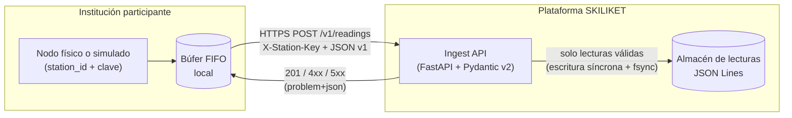

# MANUAL DE PROCESOS: ARQUITECTURA DE INTEGRACIÓN Y GOBERNANZA — PLATAFORMA FEDERADA SKILIKET

| Campo | Valor |
|---|---|
| Versión del documento | 1.0 |
| Fecha | 2026-11-11 |
| Contrato de datos que describe | Esquema `WeatherReading` v1 (`schema_version: "1.0"`), API `1.0.0` |
| Código de referencia | Este repositorio: `ingest_api/`, `station/`, `schema/`, `scripts/`, `contract_tests/`, `docker-compose.yml` |
| Estado de la plataforma | Fases A y B cerradas (contrato, API y estación simulada). Fase C (Docker y prueba de estrés) en curso. Despliegue en Azure planeado, no ejecutado |

> **Cómo leer este manual.** Todo lo que se presenta como comportamiento del sistema (endpoints, cabeceras, rangos, códigos HTTP, variables de entorno) se tomó del código fuente. Cuando una sección describe una **política** o un **plan** que el código todavía no implementa (gobernanza de datos, despliegue en Azure), se indica de forma explícita con la etiqueta **[Política]** o **[Plan]**.
>
> En el código, los identificadores técnicos usan la grafía `skilliket` (p. ej. `urn:skilliket:problem:*`, `skilliket/ingest-api:local`). Este manual conserva esa grafía en todo lo que sea código, comandos o nombres de imagen.

---

## Índice

1. [Información y propósito](#1-información-y-propósito)
2. [Protocolo de alta y homologación de nuevos nodos](#2-protocolo-de-alta-y-homologación-de-nuevos-nodos)
3. [Especificación técnica de la API](#3-especificación-técnica-de-la-api)
4. [Gobernanza y privacidad de datos](#4-gobernanza-y-privacidad-de-datos)
5. [Guía de operación local y pruebas (Docker)](#5-guía-de-operación-local-y-pruebas-docker)
6. [Plan de despliegue en la nube (Microsoft Azure)](#6-plan-de-despliegue-en-la-nube-microsoft-azure)
7. [Matriz de troubleshooting](#7-matriz-de-troubleshooting)
8. [Anexos](#8-anexos)

---

## 1. Información y propósito

### 1.1 Contexto: el Living Lab SKILIKET

SKILIKET es un *Living Lab* del Tecnológico de Monterrey, campus Guadalajara, orientado a medir variables ambientales urbanas con una red de estaciones meteorológicas. El valor de una red así crece con su cobertura: una estación aislada describe un punto; muchas estaciones, operadas por distintas instituciones, describen una ciudad.

Por eso la plataforma se diseñó como **federada**: cada institución participante (otro campus, TecMilenio, Distrito Tec, otras universidades u organismos) opera y mantiene sus propios nodos, mientras que la recepción, validación y persistencia de los datos se concentran en un **servicio de ingesta común** con un contrato de datos único y versionado. La federación descansa en tres acuerdos:

1. **Un contrato de datos estable** (esquema v1): cualquier nodo que lo cumpla puede integrarse, sin importar su hardware o lenguaje de programación.
2. **Una identidad por estación** (`station_id` + clave secreta): cada lectura se atribuye a un nodo concreto y a la institución que lo opera.
3. **Reglas de comportamiento del nodo** (reloj, búfer, reintentos): garantizan que una red heterogénea no pierda ni duplique datos.

Mientras no hay sensores físicos instalados, los nodos se emulan con una **estación simulada** (`station/`) calibrada con la climatología de Guadalajara. Esa estación es también la **implementación de referencia** del comportamiento que se exige a un nodo físico (Sección 2.4).

### 1.2 Público objetivo

| Perfil | Qué necesita de este manual | Secciones clave |
|---|---|---|
| **Coordinadores de campus o institución** | Proceso de alta, responsabilidades, clasificación y uso de los datos | 2.1, 2.2, 4 |
| **Desarrolladores de firmware y microcontroladores** | Formato exacto del payload, cabeceras, códigos de respuesta, reloj, búfer y reintentos | 2.4, 3, 7 |
| **Administradores de red y plataforma** | Credenciales, rotación de claves, operación con Docker, despliegue en Azure, diagnóstico | 2.3, 5, 6, 7 |

### 1.3 Visión general de la arquitectura



Flujo de una lectura:

1. **Generación.** Al cierre de cada intervalo (`interval_s`, 60 s por defecto) el nodo construye una lectura v1.
2. **Envío.** La lectura entra a un búfer FIFO local y se envía con `POST /v1/readings`. Solo hay una solicitud en vuelo, para preservar el orden.
3. **Validación.** El API aplica las comprobaciones en orden fijo: autenticación (401), tipo de contenido (415), tamaño (413), sintaxis JSON (400), esquema (422), correspondencia clave–estación (403) y unicidad (409).
4. **Persistencia.** Solo las lecturas que superan todo se escriben (una línea JSON con `flush` y `fsync`) **antes** de responder `201 Created`.
5. **Retroalimentación.** El código HTTP le dice al nodo si debe continuar, descartar o reintentar.

### 1.4 Justificación de la arquitectura: API REST con JSON frente a MQTT o CoAP

La decisión está registrada en [`docs/adr/0001-ingesta-y-persistencia.md`](../adr/0001-ingesta-y-persistencia.md). Para un escenario **interinstitucional**, sus razones son:

| Criterio | API REST (HTTPS + JSON), elegida | MQTT (con broker) | CoAP (UDP) |
|---|---|---|---|
| **Respuesta de validación al nodo** | Síncrona: el nodo recibe 201 o un 4xx con el campo y el código exactos del error (`errors[]`) | El broker confirma la *entrega*, no la *validez* del contenido; un consumidor aparte no puede devolver un 4xx al dispositivo | Tiene códigos de respuesta, pero exige implementar la validación y el formato de error por cuenta propia |
| **Paso por redes institucionales** | Puerto 443, el mismo que la navegación web; suele estar permitido en redes universitarias y corporativas | Puertos 1883/8883 frecuentemente bloqueados; requiere gestionar excepciones de firewall en cada institución | UDP 5683/5684 suele estar bloqueado o filtrado; NAT y firewalls complican el retorno |
| **Infraestructura adicional** | Ninguna: el contenedor del API es el servicio completo | Un broker gestionado (o IoT Hub) y un consumidor | Un servidor CoAP y, para seguridad, DTLS |
| **Herramientas para integradores** | Cualquier lenguaje con cliente HTTP; `curl` sirve para probar; contrato autodocumentado en OpenAPI (`/docs`) | Requiere cliente MQTT | Requiere biblioteca CoAP |
| **Una sola fuente de verdad del contrato** | El modelo Pydantic genera la validación, el JSON Schema publicado y OpenAPI, así que no pueden desincronizarse | El contrato del mensaje queda fuera del protocolo | Igual que MQTT |
| **Costo por mensaje** | Mayor sobrecarga de cabeceras HTTP/TLS | Muy baja | Muy baja |

El costo por mensaje es la desventaja real de HTTP, pero con una lectura por minuto y cuerpos de menos de 1 KB (el límite es 4 KB) no es relevante. Para una red federada, que cada institución pueda conectarse **sin infraestructura extra y sin abrir puertos especiales**, y que cada nodo sepa **exactamente por qué** se rechazó una lectura, pesa más.

**Ruta de evolución.** El ADR 0001 deja a **Azure IoT Hub** (MQTT/AMQP, identidad por dispositivo, X.509 y aprovisionamiento con DPS) como opción si el número de estaciones hace inmanejables las claves gestionadas a mano, si se necesitan comandos nube→dispositivo o si se exige autenticación por certificado. En ese escenario, la lógica de validación del API se reutilizaría como consumidor y el esquema v1 no cambiaría.

---

## 2. Protocolo de alta y homologación de nuevos nodos

### 2.1 Roles y responsabilidades

| Rol | Responsabilidades |
|---|---|
| **Administrador de la plataforma** (equipo SKILIKET) | Asigna prefijos y `station_id`, registra los hashes de las claves en el API, aplica la rotación y la baja de claves, opera el despliegue y conserva el registro de estaciones |
| **Coordinador de la institución participante** | Firma el acuerdo de participación y de uso de datos, designa al responsable técnico, proporciona los datos del registro de estaciones y responde por la custodia de las claves de sus nodos |
| **Responsable técnico del nodo** | Genera la clave de cada estación, configura el firmware, ejecuta las pruebas de homologación y atiende los incidentes de su nodo |

### 2.2 Proceso administrativo y técnico de alta (paso a paso)

**Fase A: solicitud y registro**

1. **Solicitud.** El coordinador de la institución envía al administrador de la plataforma: nombre de la institución, campus o sede, número de estaciones previstas, responsable técnico y medio de contacto institucional.
2. **Acuerdo de datos [Política].** Ambas partes firman el acuerdo de participación, que fija la clasificación de los datos (Sección 4.2), la atribución de la institución y el aviso de privacidad para los datos personales del registro (Sección 4.3).
3. **Asignación de identificadores.** El administrador asigna a la institución un **prefijo de tres letras mayúsculas** y un rango de números. El `station_id` debe cumplir `^[A-Z]{3}-[0-9]{3}$`; el API rechaza cualquier otro formato tanto en el payload (422) como en su configuración (no arranca).
   - Convención **[Política]**: un prefijo por campus o institución, para que el origen sea legible en los datos. La plataforma actual usa `GDL` (Tec, campus Guadalajara). Cada prefijo admite 1,000 estaciones (`000` a `999`).
   - El `station_id` es un **seudónimo técnico**: nunca debe contener nombres de personas, domicilios ni datos que identifiquen al anfitrión del nodo (Sección 4.4).
4. **Registro de estación [Política].** El administrador anota en el registro de estaciones: `station_id`, institución, responsable técnico, ubicación (coordenadas y altitud), tipo de hardware, fecha de alta y estado. Este registro **no forma parte del payload** y se clasifica como dato protegido (Sección 4.2).

**Fase B: credenciales**

5. **Generación de la clave en la institución.** El responsable técnico genera la clave **en su propio equipo** (el script solo usa la biblioteca estándar de Python 3):

   ```bash
   python scripts/gen_station_key.py
   ```

   Salida (dos líneas; la clave se muestra una sola vez y no se guarda en ningún archivo):

   ```text
   STATION_KEY=Jx2...43 caracteres en base64 urlsafe...
   SHA256=4f1c...64 caracteres hexadecimales...
   ```

6. **Entrega del hash, no de la clave.** El responsable técnico envía al administrador **solo el valor `SHA256`**. El API solo necesita el hash, así que la clave en claro nunca sale de la institución que opera el nodo. Esta es la forma recomendada de alta interinstitucional.
7. **Registro del hash en el API.** El administrador agrega la entrada a `STATION_KEY_HASHES` y reinicia el API (la configuración se lee al arrancar; ver 2.3).
8. **Carga de la clave en el nodo.** El responsable técnico configura en el nodo el `station_id` asignado y la clave en claro (`STATION_KEY`), fuera del código fuente y de cualquier archivo versionado.

**Fase C: homologación**

9. **Prueba de humo.** Enviar una lectura válida (Sección 3.6) y obtener `201`; reenviarla y obtener `409`.
10. **Prueba de contrato.** Capturar al menos 24 h de lecturas del nodo (o un día simulado por su firmware) y comprobar que todas reciben `201`. Si el equipo usa Python, puede validar sus payloads contra el modelo real con `WeatherReading.model_validate_json` (es lo que hace `contract_tests/test_contract.py` con la estación simulada).
11. **Pruebas de comportamiento** (obligatorias para nodos físicos):
    - **Corte de red:** desconectar el nodo durante al menos 5 min y verificar que, al reconectarse, todas las lecturas del periodo llegan en orden y sin huecos de `sequence`.
    - **Credencial inválida:** con una clave incorrecta, el nodo debe recibir `401` y **no** entrar en un bucle de reintentos.
    - **Reinicio del nodo:** tras un reinicio, el nodo no debe enviar lecturas hasta tener la hora sincronizada (2.4.1).
12. **Alta en producción.** El administrador marca la estación como *activa* en el registro. Desde ese momento sus datos se rigen por la clasificación de la Sección 4.

### 2.3 Gestión y provisión de credenciales

**Formato de la configuración del API.** La variable `STATION_KEY_HASHES` es un objeto JSON `{station_id: [hash1, hash2]}`:

```json
{
  "GDL-001": ["<hash SHA-256 de la clave primaria>", "<hash SHA-256 de la clave secundaria>"],
  "GDL-002": ["<hash SHA-256 de su única clave>"]
}
```

Reglas que el API valida al arrancar (si alguna falla, el API **no arranca** y muestra el motivo):

| Regla | Mensaje de error del API |
|---|---|
| La variable existe y no está vacía | `Falta STATION_KEY_HASHES; el API no acepta lecturas sin claves` |
| Es JSON válido y un objeto no vacío | `STATION_KEY_HASHES no es JSON válido: …` / `… debe ser un objeto JSON no vacío` |
| Cada clave del objeto cumple `^[A-Z]{3}-[0-9]{3}$` | `station_id inválido en STATION_KEY_HASHES: …` |
| Cada estación tiene una lista con 1 o 2 hashes | `…: se esperan entre 1 y 2 hashes en una lista` |
| Cada hash es SHA-256 en hexadecimal **minúsculas** (64 caracteres) | `…: cada hash debe ser SHA-256 en hex minúsculas` |
| Ningún hash se repite, ni dentro de una estación ni entre estaciones | `…: hash repetido (dentro de la estación o con otra)` |

**Cómo autentica el API.** Calcula el SHA-256 de la cabecera `X-Station-Key` y lo compara con **todos** los hashes registrados usando `hmac.compare_digest` (comparación en tiempo constante, sin salir antes). El hash que coincide determina la estación autenticada; si el `station_id` del cuerpo es otro, responde `403`.

**Requisitos de la clave en el nodo.** El API acepta cualquier cadena cuyo hash esté registrado, pero la estación de referencia exige (y se recomienda a todo nodo) una clave de **16 a 256 caracteres ASCII visibles, sin espacios** (`^[\x21-\x7e]{16,256}$`), segura como valor de cabecera HTTP. `gen_station_key.py` produce 43 caracteres (32 bytes aleatorios en base64 urlsafe).

**Rotación sin interrupción** (aprovecha las dos claves por estación):

1. La institución genera una clave nueva y entrega su hash.
2. El administrador agrega el hash nuevo **como segundo elemento** de la lista de la estación y reinicia el API. Ahora ambas claves son válidas.
3. La institución actualiza `STATION_KEY` en el nodo con la clave nueva.
4. Cuando el administrador ve lecturas `201` de la estación, quita el hash viejo y reinicia el API.

**Baja o revocación** (estación retirada o clave comprometida): quitar la entrada de la estación (o el hash comprometido) de `STATION_KEY_HASHES` y reiniciar el API. Desde ese momento, el nodo recibe `401` en cada lectura. Los datos ya persistidos se conservan.

**Custodia de secretos:**

- La clave en claro solo vive en el nodo (o en el archivo `.env`, ignorado por git, del entorno local). Nunca va en archivos versionados, tickets, chats ni correos.
- El API solo conoce hashes; sus logs nunca registran claves ni payloads.
- La estación de referencia envuelve la clave en un objeto `Secret` cuyo `repr`/`str` muestra `***`, y sus mensajes de error de configuración no reflejan ningún valor.

### 2.4 Requisitos obligatorios del hardware y firmware emisor

Estos requisitos se derivan del contrato del API y de la política de la estación de referencia ([`station/station/sender.py`](../../station/station/sender.py) y [`station/station/main.py`](../../station/station/main.py)). Un nodo que no los cumpla perderá o duplicará datos.

#### 2.4.1 Sincronización de reloj (NTP o RTC)

| Requisito | Motivo en el código |
|---|---|
| El nodo debe tener hora UTC correcta mediante **NTP** (recomendado) o un **RTC con respaldo de batería** sincronizado periódicamente | El API rechaza con `422 timestamp_in_future` las lecturas con más de **5 min** en el futuro y con `422 timestamp_too_old` las de más de **7 días** de antigüedad (valores por defecto de `MAX_FUTURE_SKEW_S=300` y `MAX_PAST_AGE_S=604800`) |
| El `timestamp` se envía en **UTC con sufijo `Z`**, formato RFC 3339: `2026-10-01T21:15:00Z`. Se admiten de 1 a 6 decimales de segundo; **no** se admite offset (`-06:00`) ni hora local | Validador `timestamp_format`, patrón `^[0-9]{4}-[0-9]{2}-[0-9]{2}T[0-9]{2}:[0-9]{2}:[0-9]{2}(\.[0-9]{1,6})?Z$` |
| **No transmitir antes de sincronizar la hora** tras un arranque o un corte de energía | Un nodo que arranca con el reloj en 1970 o en 2000 genera lecturas que se rechazan; peor aún, si repite timestamps ya guardados recibirá `409` y esas lecturas se tratarán como entregadas aunque sus valores sean nuevos |
| Cada lectura de una estación debe tener un **timestamp distinto y creciente**. Recomendado: múltiplos exactos del intervalo (p. ej., `hh:mm:00` con `interval_s=60`) | La clave de idempotencia es (`station_id`, `timestamp`), comparada como instante: `21:15:00Z` y `21:15:00.000Z` son la misma lectura |
| Si el reloj salta hacia atrás, **esperar** a que alcance el siguiente timestamp; no reenviar timestamps ya usados | Comportamiento de la estación de referencia ante saltos hacia atrás |
| Si el reloj salta hacia adelante (p. ej., tras una suspensión), reanclar el calendario al instante actual y **no rellenar** los intervalos perdidos | Una estación suspendida no midió; la estación de referencia omite esos ticks y registra `clock_jump` |

#### 2.4.2 Búfer local ante cortes de red

| Requisito | Detalle |
|---|---|
| **Cola FIFO acotada** | Las lecturas se encolan al generarse y se envían en orden. La estación de referencia usa `BUFFER_MAX=1000` lecturas (≈ 16.7 h a 60 s) |
| **Una sola solicitud en vuelo** | Solo se envía el frente de la cola; las demás esperan. Así se conserva el orden de entrega |
| **Desbordamiento: descartar la más vieja** | Si la cola se llena, se descarta la lectura más antigua, se cuenta y se registra (`buffer_overflow`). Las lecturas recientes son más valiosas |
| **Dimensionamiento** | El búfer no necesita cubrir más de 7 días: el API rechaza (`422 timestamp_too_old`) lo que sea más antiguo que `MAX_PAST_AGE_S` |
| **Persistencia no volátil (recomendado para hardware)** | La estación de referencia guarda el búfer **en memoria**: si el proceso muere o se corta la energía, lo pendiente se pierde. En nodos físicos se recomienda respaldar la cola en flash, tarjeta SD o FRAM, considerando el desgaste por escritura |
| **Vaciado al apagar** | Ante una señal de apagado ordenado, la estación de referencia intenta vaciar el búfer durante 10 s como máximo y reporta lo que quedó sin enviar (`unsent_at_exit`) |

Cada lectura lleva un contador `sequence` (entero ≥ 0, +1 por lectura generada). No es obligatorio, pero **se recomienda enviarlo**: los huecos de `sequence` en el almacén identifican con exactitud las lecturas perdidas o rechazadas.

#### 2.4.3 Lógica de reintentos

El nodo debe clasificar cada respuesta así (política de `station/station/sender.py`):

| Respuesta | Clasificación | Acción del nodo |
|---|---|---|
| `2xx` (201) | Entregada | Quitar del búfer y continuar |
| `409` | Entregada (duplicado) | Quitar del búfer **como éxito**: la lectura ya estaba guardada (p. ej., se perdió la respuesta del primer intento) |
| `5xx`, `408`, `429`, timeout, error de conexión o de TLS | Transitoria | **Reintentar** la misma lectura, que queda al frente del búfer, con *backoff* exponencial con *jitter* |
| `400`, `413`, `415`, `422` y demás `4xx` | Permanente | **Descartar** y registrar el `type` y los pares `field`/`code`. Reintentar no cambia el resultado |
| `401`, `403` | Permanente (configuración) | **Descartar sin reintentar** y emitir una alerta de error: la clave o el `station_id` están mal. No detener el nodo: si se corrige la configuración del API, las lecturas siguientes se aceptan solas |

**Backoff de referencia.** Tras el fallo transitorio número *n* consecutivo, esperar:

```text
espera = min(60, 1 × 2^(n−1)) × U(0.5, 1.0)   segundos
```

Es decir 0.5–1 s, 1–2 s, 2–4 s… hasta un tope de 30–60 s. El contador *n* se reinicia con cualquier resultado definitivo (entregada o descartada). El *jitter* evita que muchos nodos reintenten al mismo tiempo cuando el servicio se recupera. El API actual no envía `Retry-After`, y la estación de referencia no lo interpreta.

**Timeouts recomendados:** 5 s para conectar y 10 s para leer la respuesta (valores por defecto de la estación de referencia).

#### 2.4.4 Pseudocódigo de referencia para firmware

Pseudocódigo independiente del lenguaje y de la plataforma, equivalente a la estación de referencia:

```text
al arrancar:
    esperar_hasta(reloj_sincronizado())          # NTP o RTC válido
    seq ← leer_contador_persistente() o 0

cada interval_s, alineado a múltiplos del intervalo:
    lectura ← medir_sensores()
    lectura.timestamp ← piso(utc_ahora(), interval_s) en formato "AAAA-MM-DDThh:mm:ssZ"
    lectura.sequence  ← seq ; seq ← seq + 1
    si búfer.lleno(): búfer.descartar_más_vieja() ; registrar("buffer_overflow")
    búfer.encolar(lectura)

bucle de envío (una solicitud a la vez):
    si búfer.vacío() o ahora < reintentar_en: continuar
    respuesta ← POST(INGEST_URL, cabeceras, json_compacto(búfer.frente()))
    según respuesta:
        2xx o 409           → búfer.quitar_frente() ; fallos ← 0
        5xx, 408, 429, red  → fallos ← fallos + 1
                              reintentar_en ← ahora + min(60, 2^(fallos−1)) × aleatorio(0.5, 1)
        401 o 403           → búfer.quitar_frente() ; fallos ← 0 ; alerta("revisar clave / station_id")
        otro 4xx            → búfer.quitar_frente() ; fallos ← 0 ; registrar(type, errors[].field, errors[].code)
```

#### 2.4.5 Requisitos de serialización

- **Codificación UTF-8** y `Content-Type: application/json`.
- **Enteros como enteros.** `interval_s`, `sequence` y `wind_direction_deg` deben enviarse sin punto decimal: `60`, no `60.0` (422 `int_type`). Muchas bibliotecas JSON para microcontroladores serializan los `float` con decimales: use tipos enteros para estos campos.
- **Números como números.** `"24.7"` (texto) o `true` en un campo numérico se rechazan (422 `float_type`). En los campos de tipo número sí se aceptan enteros (`25` es válido para `air_temperature_c`).
- **Sin `NaN` ni `Infinity`** (400). Si un sensor falla, no invente un valor: omita los campos opcionales, envíe `null` donde se admite, o no envíe la lectura si el campo es obligatorio.
- **Sin campos adicionales.** Cualquier campo no declarado en el esquema se rechaza (422 `extra_forbidden`). Esto incluye el punto de rocío, que se excluyó a propósito porque se deriva de la temperatura y la humedad.
- **Tamaño máximo del cuerpo: 4,096 bytes** (413). Una lectura completa ocupa unos 350 bytes en JSON compacto.

---

## 3. Especificación técnica de la API

### 3.1 Catálogo de endpoints

| Método | Ruta | Autenticación | Descripción |
|---|---|---|---|
| `POST` | `/v1/readings` | `X-Station-Key` | Recibe, valida y persiste **una** lectura por solicitud |
| `GET` | `/health` | No | Disponibilidad del servicio. Responde `200 {"status":"ok"}`. Lo usa el healthcheck de Docker |
| `GET` | `/docs` | No | Documentación interactiva (Swagger UI) |
| `GET` | `/redoc` | No | Documentación de referencia (ReDoc) |
| `GET` | `/openapi.json` | No | Especificación OpenAPI legible por máquina: declara el esquema de seguridad `StationKey`, el cuerpo `WeatherReading` y las respuestas de error `Problem` |

El esquema del payload también se publica como archivo: [`schema/weather_reading.v1.schema.json`](../../schema/weather_reading.v1.schema.json) (JSON Schema draft 2020-12). Se genera desde el modelo con `python scripts/export_schema.py`, y una prueba automatizada falla si el archivo deja de coincidir con el modelo.

La plataforma **no expone endpoints de consulta ni de descarga de lecturas**. El acceso a los datos persistidos se hace sobre el almacén (Sección 4.5).

URL base: `http://127.0.0.1:8000` en local con Docker; `https://<FQDN de la Container App>` en Azure (Sección 6).

### 3.2 Cabeceras requeridas en `POST /v1/readings`

| Cabecera | Obligatoria | Valor | Error si falta o es inválida |
|---|---|---|---|
| `X-Station-Key` | Sí | Clave en claro de la estación | `401` |
| `Content-Type` | Sí | `application/json`. Se admite `; charset=utf-8` (o `utf8`); cualquier otro *charset* se rechaza | `415` |
| `Content-Length` | Recomendada | Longitud del cuerpo. También se aceptan envíos *chunked* | `413` si supera 4,096 bytes |

### 3.3 Estructura del payload (esquema v1)

Fuente única de verdad: [`ingest_api/app/models.py`](../../ingest_api/app/models.py). Validación **estricta** (sin conversión de tipos), **sin campos adicionales** en ningún nivel y sin `NaN`/`Infinity`.

#### 3.3.1 Raíz: metadatos de la lectura

| Campo | Tipo JSON | Oblig. | Restricción | Descripción |
|---|---|---|---|---|
| `schema_version` | string | Sí | Exactamente `"1.0"` | Versión del contrato |
| `station_id` | string | Sí | `^[A-Z]{3}-[0-9]{3}$` (solo dígitos ASCII) | Identificador asignado. Debe corresponder a la clave enviada |
| `timestamp` | string | Sí | RFC 3339 en UTC con `Z`, 0–6 decimales de segundo; dentro de la ventana `[ahora − 7 días, ahora + 5 min]` del reloj del **servidor** | Instante de la medición |
| `sequence` | integer | No | ≥ 0 | Contador de lecturas para detectar huecos |
| `interval_s` | integer | Sí | 10 a 3,600 | Duración del intervalo medido, en segundos |
| `measurements` | object | Sí | Ver 3.3.2 | Variables meteorológicas |
| `device` | object o `null` | No | Ver 3.3.3 | Diagnóstico del dispositivo |

#### 3.3.2 `measurements`: variables meteorológicas

| Campo | Tipo JSON | Unidad | Oblig. | Rango permitido | Notas |
|---|---|---|---|---|---|
| `air_temperature_c` | number | °C | Sí | −40 a 60 | Temperatura del aire |
| `relative_humidity_pct` | number | % | Sí | 0 a 100 | Humedad relativa |
| `station_pressure_hpa` | number | hPa | Sí | 500 a 1,100 | Presión **a la altura de la estación** (no reducida al nivel del mar). En Guadalajara (1,550 m) ronda los 840 hPa |
| `wind_speed_ms` | number | m/s | Sí | 0 a 75 | Velocidad media del intervalo |
| `wind_gust_ms` | number o `null` | m/s | No | 0 a 100 y **≥ `wind_speed_ms`** | Ráfaga máxima del intervalo. Si es menor que la velocidad media: 422 `gust_less_than_speed` |
| `wind_direction_deg` | integer o `null` | grados | No | 0 a 359 | Dirección **de procedencia**. `null` es válido (calma). Con viento débil también se acepta un valor numérico |
| `precipitation_mm` | number | mm | Sí | 0 a 200 | Precipitación **acumulada en el intervalo**, no acumulado diario |
| `solar_radiation_wm2` | number o `null` | W/m² | No | 0 a 1,500 | Radiación solar global |

Los límites son inclusivos (`ge`/`le`). El API no impone resolución decimal; la estación de referencia envía temperatura, presión y viento con 0.1, precipitación en múltiplos de 0.2 mm (pluviómetro de balancín) y humedad, dirección y radiación como enteros.

#### 3.3.3 `device`: metadatos y diagnóstico

| Campo | Tipo JSON | Unidad | Oblig. | Restricción |
|---|---|---|---|---|
| `battery_v` | number o `null` | V | No | 0 a 15 |
| `firmware` | string o `null` | — | No | 1 a 64 caracteres. Solo identificador de versión (p. ej., `sim-0.1.0`); nunca nombres de personas (Sección 4.4) |

#### 3.3.4 Ejemplo de lectura válida

```json
{
  "schema_version": "1.0",
  "station_id": "GDL-002",
  "timestamp": "2026-10-01T22:16:00Z",
  "sequence": 1227,
  "interval_s": 60,
  "measurements": {
    "air_temperature_c": 25.7,
    "relative_humidity_pct": 94,
    "station_pressure_hpa": 841.5,
    "wind_speed_ms": 4.5,
    "wind_gust_ms": 8.3,
    "wind_direction_deg": 235,
    "precipitation_mm": 1.0,
    "solar_radiation_wm2": 99
  },
  "device": { "battery_v": 13.61, "firmware": "sim-0.1.0" }
}
```

> Al probar a mano, cambie el `timestamp` por la hora UTC actual: un valor de hace más de 7 días recibirá `422 timestamp_too_old`.

Lectura mínima válida (solo campos obligatorios):

```json
{
  "schema_version": "1.0",
  "station_id": "GDL-001",
  "timestamp": "2026-11-11T18:00:00Z",
  "interval_s": 60,
  "measurements": {
    "air_temperature_c": 24,
    "relative_humidity_pct": 40,
    "station_pressure_hpa": 840.2,
    "wind_speed_ms": 0,
    "precipitation_mm": 0
  }
}
```

### 3.4 Orden de las comprobaciones

El API evalúa en este orden y responde con el **primer** fallo:

```text
401 (clave) → 415 (Content-Type) → 413 (tamaño) → 400 (sintaxis JSON) → 422 (esquema) → 403 (clave ≠ station_id) → 409 (duplicado) → 201
```

La autenticación va primero a propósito: un cliente sin clave válida recibe 401 aunque su cuerpo esté corrupto, y no obtiene información sobre el esquema. El cuerpo se lee a mano con un tope de 4,096 bytes, también en envíos *chunked*, para que ese orden se cumpla.

### 3.5 Respuestas y mapeo de códigos HTTP

**Éxito (`201 Created`, `application/json`):**

```json
{
  "status": "created",
  "reading_id": "6960c610-efd2-4e80-8090-7d13e5145f1f",
  "station_id": "GDL-001",
  "received_at": "2026-11-11T22:07:15.391528Z"
}
```

`reading_id` es un UUID v4 asignado por el servidor; `received_at` es la hora del servidor en UTC. La respuesta se envía **después** de escribir la lectura en disco.

**Errores (`application/problem+json`, RFC 9457):**

```json
{
  "type": "urn:skilliket:problem:validation-error",
  "title": "Validation failed",
  "status": 422,
  "detail": "El payload no cumple el esquema v1 (1 error(es))",
  "instance": "/v1/readings",
  "errors": [
    {
      "field": "measurements.wind_speed_ms",
      "code": "float_type",
      "message": "Input should be a valid number",
      "value": true
    }
  ]
}
```

En `errors[]`, `field` es la ruta del campo con puntos, `code` es el identificador estable del error (**programe contra `code`, no contra `message`**, que es texto libre y puede estar en inglés), y `value` refleja el valor recibido (cadenas truncadas a 100 caracteres; nunca objetos completos; `null` si el campo faltaba).

| Código | `type` (`urn:skilliket:problem:…`) | Causa | Campos extra | Acción del nodo |
|---|---|---|---|---|
| **201** | — | Lectura validada y persistida | — | Continuar |
| **400** | `malformed-json` | JSON sintácticamente inválido, cuerpo no UTF-8, `NaN`/`Infinity`, anidamiento excesivo | `line`, `column` | Descartar y corregir el serializador |
| **401** | `unauthorized` | Falta `X-Station-Key` o su hash no está registrado | — | Descartar **sin reintentar**; revisar la clave |
| **403** | `forbidden` | La clave es válida pero pertenece a otro `station_id` | — | Descartar **sin reintentar**; revisar `STATION_ID`/`STATION_KEY` |
| **404** | `not-found` | Ruta inexistente (p. ej., falta `/v1` en la URL) | — | Corregir `INGEST_URL` |
| **405** | `method-not-allowed` | Método distinto de `POST` en `/v1/readings` (incluye cabecera `Allow: POST`) | — | Corregir el cliente |
| **409** | `duplicate-reading` | Ya existe una lectura con ese (`station_id`, `timestamp`) | — | **Tratar como éxito** (idempotencia) |
| **413** | `payload-too-large` | Cuerpo de más de 4,096 bytes | — | Descartar; revisar qué se está enviando |
| **415** | `unsupported-media-type` | `Content-Type` ausente, distinto de `application/json` o con *charset* que no es UTF-8 | — | Corregir la cabecera |
| **422** | `validation-error` | El JSON es válido pero no cumple el esquema v1 | `errors[]` | Descartar y registrar `field`/`code` |
| **500** | `internal-error` | Error del servidor (p. ej., fallo de escritura en disco). El detalle es genérico (`Error interno`) | — | Reintentar con *backoff* |
| **Sin respuesta** | — | Timeout, conexión rechazada, DNS o TLS | — | Reintentar con *backoff* |

#### 3.5.1 Códigos de error `422` más frecuentes

| `code` | Ejemplo de causa |
|---|---|
| `missing` | Falta un campo obligatorio (p. ej., `measurements.station_pressure_hpa`) |
| `extra_forbidden` | Campo no declarado (p. ej., `dew_point_c`) |
| `float_type` | Número enviado como texto o booleano |
| `int_type` | Entero enviado con decimales (`60.0`) o como texto |
| `string_type` | Se esperaba una cadena (p. ej., `station_id` numérico) |
| `literal_error` | `schema_version` distinto de `"1.0"` |
| `greater_than_equal` / `less_than_equal` | Valor fuera de rango (p. ej., humedad 101) |
| `string_pattern_mismatch` | `station_id` con formato inválido (p. ej., `gdl-1`) |
| `string_too_short` / `string_too_long` | `device.firmware` vacío o de más de 64 caracteres |
| `gust_less_than_speed` | `wind_gust_ms` < `wind_speed_ms` |
| `timestamp_format` | `timestamp` sin `Z`, con offset, en hora local o con fecha imposible |
| `timestamp_in_future` | `timestamp` más de `MAX_FUTURE_SKEW_S` (300 s) adelante del reloj del servidor |
| `timestamp_too_old` | `timestamp` más de `MAX_PAST_AGE_S` (7 días) atrás |

### 3.6 Ejemplo de invocación con `curl`

Guarde el payload en `lectura.json` (con el `timestamp` actualizado) y ejecute (en PowerShell use `curl.exe` en lugar de `curl`):

```bash
curl -i -X POST http://127.0.0.1:8000/v1/readings \
  -H "Content-Type: application/json" \
  -H "X-Station-Key: $STATION_KEY" \
  --data-binary @lectura.json
```

Resultado esperado: `HTTP/1.1 201 Created` la primera vez y `HTTP/1.1 409 Conflict` al repetir el mismo comando.

### 3.7 Persistencia (lo que guarda el API)

Cada lectura aceptada se agrega como una línea JSON al archivo `STORAGE_PATH` (por defecto `./data/readings.jsonl`; `/data/readings.jsonl` en la imagen Docker):

```json
{"reading_id":"…","received_at":"2026-11-11T22:07:15.391528Z","reading":{ …payload normalizado… }}
```

- `reading` contiene el payload validado; los campos opcionales que no se enviaron no aparecen.
- La escritura es síncrona, bajo un lock, como una sola operación seguida de `flush` y `fsync`.
- Un fallo de `fsync` puede dejar la misma lectura dos veces en el archivo (ADR 0001, *Límites conocidos*). **Todo consumidor del JSONL debe deduplicar por (`station_id`, `timestamp`).**

### 3.8 Configuración del API (variables de entorno)

| Variable | Defecto | Descripción |
|---|---|---|
| `STATION_KEY_HASHES` | — (obligatoria) | JSON `{station_id: [hash, …]}` (Sección 2.3) |
| `STORAGE_PATH` | `./data/readings.jsonl` (imagen: `/data/readings.jsonl`) | Archivo JSON Lines de lecturas |
| `MAX_FUTURE_SKEW_S` | `300` | Segundos que un `timestamp` puede ir adelante del reloj del servidor |
| `MAX_PAST_AGE_S` | `604800` (7 días) | Antigüedad máxima aceptada de un `timestamp` |

El API **no lee archivos `.env`**: solo variables de entorno reales. El archivo `.env` lo consume `docker compose`.

---

## 4. Gobernanza y privacidad de datos

> **[Política]** Esta sección establece reglas de gobernanza para la operación federada. El código actual **no implementa** clasificación por niveles, control de acceso de lectura ni endpoints de consulta: el API solo recibe y guarda. Las medidas técnicas que **sí** existen en el código se señalan con ✔.

### 4.1 Principios

1. **Minimización desde el contrato.** El esquema v1 solo admite variables físicas y diagnóstico del equipo. ✔ Cualquier campo adicional se rechaza (`extra_forbidden`), así que un nodo no puede introducir datos personales en una lectura aunque lo intente.
2. **Seudonimización de origen.** Las lecturas se atribuyen a un `station_id`, no a una persona ni a un domicilio. ✔ El formato `AAA-000` no admite texto libre.
3. **Ubicación fuera del payload.** ✔ La lectura no lleva coordenadas. La ubicación de cada estación vive solo en el registro de estaciones, que es el elemento más sensible del sistema.
4. **Secretos nunca en claro.** ✔ El servidor guarda solo hashes de las claves; los logs no contienen claves ni payloads.
5. **Atribución y soberanía.** Cada institución conserva la atribución de los datos de sus nodos y decide, dentro de este marco, su nivel de apertura.

### 4.2 Esquema de separación de datos

| Nivel | Contenido | Quién accede | Condiciones de uso |
|---|---|---|---|
| **N1 — Público / abierto** | Variables de `measurements`, `timestamp`, `interval_s` y `station_id`; agregados (promedios horarios y diarios, máximos, mínimos, acumulados de lluvia); metadatos públicos de la estación: institución, altitud y **coordenadas generalizadas** (Sección 4.4) | Cualquier persona | Licencia abierta con atribución (se recomienda CC BY 4.0), citando a SKILIKET y a la institución operadora. Publicación después del control de calidad |
| **N2 — Institucional** | Registro crudo completo: `reading_id`, `received_at`, `sequence`, `device.battery_v`, `device.firmware`; logs operativos del API y de los nodos; resultados de pruebas | Equipo SKILIKET e instituciones participantes (cada institución ve completo lo de sus nodos) | Uso académico, de operación y de mantenimiento. No se redistribuye fuera de las instituciones participantes |
| **N3 — Protegido / licenciable** | Registro de estaciones (coordenadas exactas, responsables técnicos, contactos, anfitriones del nodo); series de alta resolución de estaciones en propiedad privada o sujetas a convenio; cualquier entrega para fines comerciales | Administrador de la plataforma y personas designadas por convenio | Acceso nominal y registrado. Uso comercial o por terceros solo mediante licencia o convenio específico con la institución operadora |
| **Secretos** (fuera de clasificación) | Claves de estación en claro, `STATION_KEY_HASHES`, credenciales de nube | Solo los sistemas que los usan | Nunca se publican ni se comparten. Bóveda de secretos (Key Vault, Sección 6) |

**Reglas de paso entre niveles:**

- N2 → N1: solo mediante un proceso de publicación que deduplique por (`station_id`, `timestamp`), excluya los campos de N2 y generalice la ubicación.
- N3 → cualquier otro nivel: requiere autorización escrita de la institución operadora y, si hay datos personales, una disociación previa (4.3).

### 4.3 Marco normativo mexicano (LFPDPPP)

Las **lecturas meteorológicas no son datos personales**: describen el ambiente, no a una persona. Los datos personales de la plataforma están en otros lugares:

| Dónde | Dato personal | Tratamiento |
|---|---|---|
| Registro de estaciones (N3) | Nombre, correo y teléfono del responsable técnico o del anfitrión del nodo | Requiere aviso de privacidad y consentimiento conforme a la ley |
| Registro de estaciones (N3) | Coordenadas exactas de un nodo instalado en una **vivienda** | Puede hacer identificable a su ocupante: se trata como dato personal |
| Logs de acceso del servidor (N2) | Dirección IP del cliente. Uvicorn la registra por defecto en su log de acceso | Puede ser dato personal si el nodo opera desde la conexión doméstica de una persona; se aplica un plazo de retención limitado |

**Ley aplicable.** Las instituciones **privadas** (p. ej., el Tecnológico de Monterrey o TecMilenio) son *responsables* en términos de la **Ley Federal de Protección de Datos Personales en Posesión de los Particulares (LFPDPPP)**. La ley vigente se publicó en el DOF el 20 de marzo de 2025 y sustituyó a la de 2010; las funciones del extinto INAI en esta materia pasaron a la Secretaría Anticorrupción y Buen Gobierno. Las instituciones **públicas** participantes (universidades públicas, dependencias de gobierno) se rigen por la ley general aplicable a los sujetos obligados del sector público. Cada institución debe validar este marco con su área jurídica antes de firmar el acuerdo de datos.

**Obligaciones operativas derivadas:**

1. **Aviso de privacidad.** Se entrega al responsable técnico y, en su caso, al anfitrión de cada nodo antes de recabar sus datos para el registro.
2. **Finalidad limitada.** Los datos de contacto solo se usan para operar la red (alta, incidentes, rotación de claves).
3. **Derechos ARCO.** Las solicitudes de acceso, rectificación, cancelación u oposición se canalizan al área de datos personales de la institución responsable del registro. La baja de un responsable no borra las lecturas de la estación, que no son datos personales.
4. **Encargados.** Si el almacén se aloja en un proveedor de nube (Azure), el proveedor actúa como encargado y debe quedar cubierto por el contrato correspondiente.
5. **Medidas de seguridad.** Acceso nominal a N3, cifrado en reposo y en tránsito, bitácora de accesos y retención limitada.

### 4.4 Criterios de disociación y anonimización

La LFPDPPP llama **disociación** al procedimiento por el cual los datos no pueden asociarse a su titular ni permitir su identificación. Para la plataforma se aplican estos criterios:

| # | Criterio | Implementación |
|---|---|---|
| D1 | **`station_id` sin significado personal.** Prefijo institucional y número secuencial; nunca nombres, domicilios ni números de casa | ✔ El patrón `^[A-Z]{3}-[0-9]{3}$` lo hace imposible. **[Política]** El administrador asigna los números y no se reutilizan |
| D2 | **Tabla de correspondencia separada.** La relación `station_id` → anfitrión/coordenadas exactas existe solo en el registro N3, con acceso restringido | **[Política]** |
| D3 | **Generalización de la ubicación.** Para publicar (N1), las coordenadas de nodos en propiedad privada se redondean a **2 decimales** (≈ 1.1 km). Las de nodos en edificios institucionales pueden publicarse exactas si la institución lo autoriza | **[Política]**. El payload no lleva coordenadas (✔), así que la generalización se aplica sobre el registro |
| D4 | **Campos de texto libre sin datos personales.** `device.firmware` solo lleva identificadores de versión | ✔ Longitud máxima de 64 caracteres. **[Política]** Se revisa en la homologación |
| D5 | **Sin datos personales en el payload** | ✔ `extra_forbidden`: el esquema no admite campos ajenos al contrato |
| D6 | **Logs sin secretos ni contenido** | ✔ Los logs de la app registran evento, estado, `station_id`, `reading_id` y códigos de error, nunca claves ni payloads. **[Política]** El log de acceso de uvicorn (que incluye IP) se conserva 30 días como máximo |
| D7 | **Agregación antes de publicar series de nodos sensibles.** Si una estación está en una vivienda, la serie publicada (N1) se agrega como mínimo a promedios horarios | **[Política]** Evita inferir patrones de ocupación a partir de variaciones de diagnóstico, como la batería |
| D8 | **Baja de un anfitrión.** Al dar de baja a un anfitrión privado se eliminan sus datos de contacto del registro y se conserva solo el `station_id`, la institución y la ubicación generalizada | **[Política]** |

### 4.5 Retención y acceso al almacén [Política]

| Activo | Retención propuesta | Acceso |
|---|---|---|
| Lecturas crudas (JSONL o futuro Blob) | Indefinida (valor científico) | N2 |
| Publicación agregada | Indefinida | N1 |
| Logs operativos de la aplicación | 180 días | N2 |
| Logs de acceso con IP | 30 días | Administradores |
| Registro de estaciones | Mientras la estación esté activa + 1 año; luego solo los datos disociados (D8) | N3 |

El JSONL actual no se rota ni se compacta, y el API lo lee completo al arrancar para reconstruir el índice de duplicados (ADR 0001). Archivar o rotar el archivo es una tarea de operación: debe hacerse con el API detenido y sin quitar las lecturas de los últimos 7 días, que el índice necesita para detectar duplicados.

---

## 5. Guía de operación local y pruebas (Docker)

### 5.1 Requisitos

- Docker Desktop, o Docker Engine con Compose v2.
- Python 3 para generar claves (`scripts/gen_station_key.py` solo usa la biblioteca estándar). Para correr las suites de pruebas y la prueba de estrés: **Python 3.13** con un entorno virtual.
- Puerto `8000` libre en `127.0.0.1`.

### 5.2 Componentes del entorno local

`docker-compose.yml` (proyecto `skilliket`) define:

| Servicio | Imagen | Función |
|---|---|---|
| `api` | `skilliket/ingest-api:local` (desde `ingest_api/Dockerfile`) | API de ingesta. Publicado solo en `127.0.0.1:8000`. Persiste en el volumen `readings` (`/data`). Healthcheck contra `/health` |
| `station-gdl-001`, `station-gdl-002`, `station-gdl-003` | `skilliket/station:local` (desde `station/Dockerfile`) | Tres estaciones simuladas. Esperan a que `api` esté *healthy* (`depends_on: condition: service_healthy`) y envían a `http://api:8000/v1/readings` |

Ambas imágenes parten de `python:3.13-slim` y corren con un usuario sin privilegios (UID 10001). El API corre con **un solo worker** de uvicorn porque el índice de duplicados y el lock viven en memoria.

### 5.3 Puesta en marcha paso a paso

1. **Crear el archivo de entorno** desde la raíz del repositorio:

   ```powershell
   copy .env.example .env        # en Linux/macOS: cp .env.example .env
   ```

2. **Generar una clave por estación** (tres veces):

   ```powershell
   python scripts\gen_station_key.py
   ```

3. **Rellenar `.env`.** Los tres hashes van en `STATION_KEY_HASHES` (una línea, JSON) y cada clave en claro en su variable:

   ```dotenv
   STATION_KEY_HASHES={"GDL-001": ["<SHA256 de la 1.ª ejecución>"], "GDL-002": ["<SHA256 de la 2.ª>"], "GDL-003": ["<SHA256 de la 3.ª>"]}
   STATION_KEY_GDL_001=<STATION_KEY de la 1.ª ejecución>
   STATION_KEY_GDL_002=<STATION_KEY de la 2.ª ejecución>
   STATION_KEY_GDL_003=<STATION_KEY de la 3.ª ejecución>
   ```

   Si falta alguna de estas variables, `docker compose` se niega a arrancar con el mensaje `define … en .env`. `.env` está ignorado por git: es el único lugar donde se escriben las claves en claro.

4. **Construir y levantar:**

   ```powershell
   docker compose up --build
   ```

   El API tiene un `start-period` de 90 s en su healthcheck; en equipos con CPU limitada, las estaciones pueden tardar en arrancar mientras el API pasa a *healthy*.

5. **Verificar:**

   | Comprobación | Cómo |
   |---|---|
   | API disponible | `curl http://127.0.0.1:8000/health` → `{"status":"ok"}` |
   | Contrato interactivo | Abrir `http://127.0.0.1:8000/docs` |
   | Lecturas aceptadas | En los logs del API, eventos `"reading_created"` con `"status": 201` |
   | Lecturas guardadas | `docker compose exec api tail -n 3 /data/readings.jsonl` |
   | Copia local del almacén | `docker compose cp api:/data/readings.jsonl ./readings.jsonl` |

6. **Detener:**

   ```powershell
   docker compose down        # conserva el volumen "readings"
   docker compose down -v     # además BORRA el volumen y todas las lecturas
   ```

   Con `docker stop` o `down`, cada estación recibe SIGTERM, intenta vaciar su búfer durante 10 s e imprime su resumen (`event: summary`).

### 5.4 Parámetros de la simulación en compose

Se toman de `.env` o de variables de la terminal (las de la terminal tienen precedencia):

| Variable | Defecto en compose | Efecto |
|---|---|---|
| `INTERVAL_S` | `60` | Segundos entre lecturas (10–3600) |
| `REPLAY_HOURS` | `0` | Horas de historia que cada estación reenvía al arrancar (máx. 167) |
| `REPLAY_DURATION_MIN` | `2` | Minutos en que se reparte la réplica (0 = lo más rápido posible) |
| `FAULT_RATE` | `0` | Fracción de lecturas corrompidas a propósito (0.0–1.0) |
| `MAX_READINGS` | `0` | La estación termina tras entregar o descartar N lecturas (0 = sin límite) |
| `MAX_FUTURE_SKEW_S`, `MAX_PAST_AGE_S` | `300`, `604800` | Ventana del `timestamp` en el API |

La estación admite además `SEED`, `LAT`, `LON`, `ELEVATION_M`, `TZ_OFFSET_H`, `PREVAILING_WIND_DEG`, `BUFFER_MAX`, `HTTP_CONNECT_TIMEOUT_S` y `HTTP_READ_TIMEOUT_S` (ver [`station/.env.example`](../../station/.env.example)). Para usarlas en compose hay que agregarlas al bloque `environment` de cada estación.

**Demo rápida con historia:** `REPLAY_HOURS=2` y `REPLAY_DURATION_MIN=0` envían las últimas 2 h al arrancar y luego siguen en vivo.

### 5.5 Inyección de errores: comprobación de resiliencia

#### 5.5.1 Fallas de validación (422)

Con `FAULT_RATE > 0`, cada estación toma una fracción de sus lecturas y les aplica **una** de nueve mutaciones, cada una con el error exacto que el API debe devolver:

| Falla | Mutación | `field` esperado | `code` esperado |
|---|---|---|---|
| `humidity_over_100` | HR = 101 | `measurements.relative_humidity_pct` | `less_than_equal` |
| `temperature_below_min` | T = −41 | `measurements.air_temperature_c` | `greater_than_equal` |
| `gust_below_speed` | ráfaga = velocidad − 0.5 | `measurements.wind_gust_ms` | `gust_less_than_speed` |
| `extra_field` | `"unexpected_field": 1` | `unexpected_field` | `extra_forbidden` |
| `missing_required` | sin `station_pressure_hpa` | `measurements.station_pressure_hpa` | `missing` |
| `string_in_number` | T como texto | `measurements.air_temperature_c` | `float_type` |
| `future_timestamp` | reloj actual + 10 min | `timestamp` | `timestamp_in_future` |
| `bad_schema_version` | `"2.0"` | `schema_version` | `literal_error` |
| `float_in_integer` | `interval_s` como flotante | `interval_s` | `int_type` |

```powershell
$env:FAULT_RATE = "0.3"; docker compose up
```

**Cómo leer el resultado:** cada falla genera en el log de la estación un evento `fault_confirmed` (el 422 trajo exactamente el par esperado) o `fault_mismatch` (no fue así, con `expected` y `received`). El resumen final incluye `faults_injected`, `faults_confirmed` y `faults_unexpected`. **Criterio de aceptación:** `faults_unexpected = 0`, y los huecos de `sequence` en el JSONL coinciden con las lecturas mutadas.

#### 5.5.2 Caída del servicio (búfer y reintentos)

Con el entorno corriendo:

```powershell
docker compose stop api      # las estaciones registran "send_retry" y acumulan en el búfer
# esperar 1–2 intervalos
docker compose start api     # las estaciones vacían el búfer en orden
```

**Criterio de aceptación:** cada estación entrega todas las lecturas del periodo en orden, sin huecos de `sequence` ni duplicados en el JSONL. Como referencia, en la verificación de la Fase B una caída de 50 s con intervalos de 10 s se recuperó sin pérdidas (18/18 lecturas, 6 reintentos de 0.94 a 26.7 s).

#### 5.5.3 Prueba de estrés con nodos maliciosos

[`scripts/stress_docker.py`](../../scripts/stress_docker.py) levanta su **propio** compose (sin puertos publicados) con:

- **N estaciones legítimas** que reenvían horas de historia lo más rápido posible, con `FAULT_RATE` de lecturas corruptas (422 esperado);
- **intrusos** con claves aleatorias no registradas (401 esperado);
- un **suplantador** que usa la clave de `GDL-001` pero declara ser `GDL-002` (403 esperado).

```powershell
.\.venv\Scripts\python.exe scripts\stress_docker.py --stations 10 --intruders 2 --hours 24 --fault-rate 0.3
```

| Opción | Defecto | Descripción |
|---|---|---|
| `--stations` | 10 | Estaciones legítimas |
| `--intruders` | 2 | Nodos con clave no registrada |
| `--spoofers` | 1 | 0 o 1 suplantador (requiere ≥ 2 estaciones) |
| `--hours` | 24 | Horas de historia por estación |
| `--interval` | 60 | `interval_s` de las lecturas |
| `--fault-rate` | 0.3 | Fracción de lecturas corruptas |
| `--rogue-readings` | 240 | Lecturas por intruso o suplantador |
| `--no-build` | — | Reutiliza las imágenes ya construidas |

Las claves se generan en memoria y solo llegan a los contenedores como variables de entorno. Al terminar, el script cruza tres fuentes (log del API, resumen de cada nodo y JSONL persistido), escribe `data/stress/<run>/results.json` y **sale con código 0 solo si pasan todas estas comprobaciones**:

| Comprobación | Significado |
|---|---|
| `all_containers_exit_0` | Todos los nodos terminaron bien |
| `requests_equal_expected` | El API recibió exactamente las solicitudes esperadas |
| `api_201_eq_station_created_eq_jsonl` | 201 del API = lecturas creadas según los nodos = líneas del JSONL |
| `api_422_eq_faults_injected_eq_confirmed` | Cada falla inyectada recibió su 422 exacto |
| `api_401_eq_intruder_drops` / `api_403_eq_spoofer_drops` | Intrusos y suplantador fueron rechazados en el 100 % de los casos |
| `no_409_no_5xx` | Sin duplicados ni errores del servidor |
| `no_collisions_jsonl` | Todas las líneas son JSON válido y únicas por (`station_id`, `timestamp`) |
| `no_writes_for_rogue_nodes` | Los nodos maliciosos no escribieron nada |
| `sequence_gaps_equal_faults` | Los huecos de `sequence` son exactamente las fallas |
| `no_plaintext_keys` | Ninguna clave en claro aparece en logs, datos ni compose generado |

Línea base registrada (10 estaciones, 2 intrusos, 1 suplantador, 24 h, `FAULT_RATE=0.3`): 15,120 solicitudes, 0 colisiones, 0 errores 5xx y ≈ 249 solicitudes/s sostenidas en un solo proceso ([`docs/paper/secciones-resultados-y-contrato.md`](../paper/secciones-resultados-y-contrato.md)).

### 5.6 Suites de pruebas automatizadas

Preparar el entorno virtual (una vez):

```powershell
py -3.13 -m venv .venv
.\.venv\Scripts\python.exe -m pip install -r ingest_api\requirements-dev.txt -r station\requirements-dev.txt
```

Cada suite se corre **desde su carpeta**: `ingest_api/tests` y `station/tests` chocarían como paquete `tests` en una misma sesión de pytest.

```powershell
cd ingest_api;     ..\.venv\Scripts\python.exe -m pytest; cd ..
cd station;        ..\.venv\Scripts\python.exe -m pytest; cd ..
cd contract_tests; ..\.venv\Scripts\python.exe -m pytest; cd ..
```

| Suite | Qué verifica |
|---|---|
| `ingest_api/` | Modelo y validadores, autenticación y rotación, orden de códigos HTTP, formato problem+json, almacenamiento JSONL (duplicados, líneas corruptas, fallos de escritura), generador de claves, coincidencia del JSON Schema publicado con el modelo |
| `station/` | Configuración (fail-fast), modelo meteorológico (24 h × 20 semillas × 3 intervalos; tarda ≈ 1 min), catálogo de fallas, emisor (clasificación, *backoff*, búfer), bucle principal (ticks, réplica, saltos de reloj, señales) |
| `contract_tests/` | 4,320 payloads generados (3 estaciones × 24 h) son válidos contra el modelo **real** del API, y cada falla del catálogo produce exactamente su (`field`, `code`) |

Si se modifica `ingest_api/app/models.py`, hay que regenerar el esquema publicado con `python scripts/export_schema.py`; de lo contrario, una prueba falla.

---

## 6. Plan de despliegue en la nube (Microsoft Azure)

> **[Plan]** El despliegue en Azure está diseñado (ADR 0001 y documento del artículo) pero **no se ha ejecutado**; está previsto para cuando se active el entorno de pruebas de Azure (enero de 2027). El contrato v1, los códigos de respuesta y la autenticación no cambian: un nodo pasa de local a nube **cambiando solo su `INGEST_URL`**.

### 6.1 Equivalencias de componentes

| Componente local | Servicio en Azure | Estado |
|---|---|---|
| Contenedor `api` (Docker) | **Azure Container Apps**, plan Consumption, **misma imagen** | Imagen lista |
| Construcción local de la imagen | **Azure Container Registry (ACR)**; la Container App descarga la imagen con identidad administrada (rol *AcrPull*) | Por configurar |
| `STATION_KEY_HASHES` en `.env` | Secreto de Container Apps con **referencia a Azure Key Vault**, leído con identidad administrada (rol *Key Vault Secrets User*) | Diseñado |
| `JsonlStorage` en volumen Docker | **Azure Blob Storage** mediante un nuevo adaptador sobre la interfaz `StorageAdapter` (almacenamiento masivo; con espacio de nombres jerárquico, Data Lake Storage Gen2, para analítica) | **Diseñado, no implementado** |
| Índice de duplicados en memoria | Nombre de blob determinista por (`station_id`, `timestamp`) con escritura condicional | Diseñado. Mientras se use JSONL: `maxReplicas = 1` |
| HTTP dentro de la red de Docker | HTTPS con TLS terminado en la *ingress* de Container Apps | Lo provee la plataforma |
| Healthcheck de Docker contra `/health` | Sondas de *liveness* y *readiness* de Container Apps contra `/health`, puerto 8000 (el `HEALTHCHECK` del Dockerfile no lo usa Container Apps) | Endpoint listo |
| Logs JSON en stdout | **Log Analytics** del entorno de Container Apps | Lo provee la plataforma |

### 6.2 Etapas de despliegue

**Etapa 1: despliegue con el adaptador actual (JSONL).** Permite validar en la nube sin escribir código nuevo, con estas condiciones obligatorias:

- **`minReplicas = 1` y `maxReplicas = 1`.** `JsonlStorage` solo es correcto con un proceso: con dos réplicas, ambas podrían aceptar la misma lectura y escribir el mismo archivo. Además, con escalado a cero cada arranque relee el JSONL completo (arranque en frío).
- **Volumen persistente** montado en `/data` (Azure Files). El sistema de archivos del contenedor es efímero: sin volumen, las lecturas se pierden en cada reinicio o revisión. La durabilidad del `fsync` sobre un recurso compartido de red debe verificarse en esta etapa.

**Etapa 2: adaptador de Blob Storage.** Implementar un `StorageAdapter` que escriba un blob por lectura con nombre determinista (p. ej., por `station_id`/fecha/`timestamp`) y escritura condicional (*si no existe*), traduciendo el conflicto a `DuplicateReadingError` (→ 409). Con eso desaparece el índice en memoria y se pueden permitir varias réplicas.

**Plan de validación** (del documento del artículo):

1. Desplegar la imagen y registrar en Key Vault los hashes de las estaciones participantes.
2. Ejecutar contra el endpoint en la nube la suite de contrato y la prueba de estrés, cambiando solo el destino.
3. Comparar con la línea base local y medir por primera vez la latencia de extremo a extremo por Internet.

### 6.3 Variables de entorno críticas

**API (Container App):**

| Variable | Valor en Azure | Observación |
|---|---|---|
| `STATION_KEY_HASHES` | `secretref:` a un secreto de Container Apps que referencia a Key Vault | **Nunca** como valor literal en la plantilla. La configuración se lee al arrancar: tras rotar el secreto, hay que reiniciar la revisión |
| `STORAGE_PATH` | `/data/readings.jsonl` (ya es el valor por defecto de la imagen) | Solo en la Etapa 1; debe apuntar al volumen persistente |
| `MAX_FUTURE_SKEW_S` | `300` | Ampliarlo solo si hay nodos con deriva de reloj conocida y no corregible |
| `MAX_PAST_AGE_S` | `604800` | Define cuánto tiempo puede un nodo recuperar lecturas tras un corte, y el tamaño del índice de duplicados |

**Nodos:**

| Variable | Valor | Observación |
|---|---|---|
| `INGEST_URL` | `https://<FQDN de la Container App>/v1/readings` | **Siempre `https`** fuera de la red local: la clave viaja en una cabecera |
| `STATION_ID`, `STATION_KEY` | Los asignados en el alta | La clave en el almacén de secretos del dispositivo o del entorno del nodo |

### 6.4 Referencia de comandos (Azure CLI)

Ejemplo ilustrativo de la Etapa 1. Los nombres (`rg-skiliket`, `kv-skiliket`, `acrskiliket`, `cae-skiliket`, `id-skiliket-api`) son ejemplos que cada equipo sustituye por los de su suscripción:

```bash
# 1. Publicar la imagen en ACR (construcción en la nube desde la carpeta del API)
az acr build --registry acrskiliket --image skilliket/ingest-api:1.0.0 ./ingest_api

# 2. Guardar los hashes en Key Vault (el archivo contiene solo hashes, nunca claves)
az keyvault secret set --vault-name kv-skiliket --name station-key-hashes --file station_key_hashes.json

# 3. Crear la Container App con identidad administrada, ingress HTTPS y una sola réplica
az containerapp create \
  --name ca-skiliket-ingest --resource-group rg-skiliket --environment cae-skiliket \
  --image acrskiliket.azurecr.io/skilliket/ingest-api:1.0.0 \
  --registry-server acrskiliket.azurecr.io --registry-identity "$IDENTITY_RESOURCE_ID" \
  --user-assigned "$IDENTITY_RESOURCE_ID" \
  --target-port 8000 --ingress external \
  --min-replicas 1 --max-replicas 1 \
  --secrets "station-key-hashes=keyvaultref:$SECRET_URI,identityref:$IDENTITY_RESOURCE_ID" \
  --env-vars "STATION_KEY_HASHES=secretref:station-key-hashes"
```

`$IDENTITY_RESOURCE_ID` es el identificador de recurso de la identidad administrada asignada por el usuario (con roles *AcrPull* sobre el registro y *Key Vault Secrets User* sobre la bóveda), y `$SECRET_URI` es el URI del secreto en Key Vault. El montaje del volumen de Azure Files en `/data` y las sondas de salud sobre `/health` se declaran en la especificación YAML de la Container App (`az containerapp update --yaml`).

### 6.5 Consideraciones de red y seguridad

| Tema | Medida |
|---|---|
| **Transporte** | Ingress solo HTTPS (desactivar el tráfico HTTP inseguro). TLS 1.2 o superior. Los nodos deben validar el certificado del servidor; en microcontroladores, cargar el certificado raíz de la cadena |
| **Exposición** | El API es el único componente público. Key Vault, Storage y ACR se acceden por identidad administrada; se recomienda restringir su acceso público (*firewall* de recurso o *private endpoints*) |
| **Restricción por origen** | Si las instituciones salen a Internet por IPs fijas, las reglas de restricción de IP de la ingress de Container Apps limitan quién puede llegar al API |
| **Abuso y volumen** | El API limita el cuerpo a 4 KB, pero **no implementa limitación de tasa**. Si se necesita, debe agregarse delante (p. ej., Azure API Management o Front Door con WAF) |
| **Secretos** | Sin secretos en plantillas, imágenes ni repositorio. Rotación según la Sección 2.3, con reinicio de revisión tras cambiar el secreto |
| **Logs** | La aplicación no registra claves ni payloads. El log de acceso de uvicorn incluye la IP del cliente (o del proxy de la ingress): aplicar la retención de la Sección 4.5 en Log Analytics |
| **Residencia de datos** | Elegir la región de Azure conforme a los acuerdos con las instituciones y a la clasificación de la Sección 4.2 |
| **Ruta de evolución** | Si crecen el número de nodos o los requisitos de identidad: Azure IoT Hub (X.509, DPS) o JWT de Entra ID / mTLS en la ingress (ADR 0001) |

---

## 7. Matriz de troubleshooting

### 7.1 Lado del nodo (administradores de estaciones remotas)

| Síntoma (respuesta o evento de log) | Causa raíz probable | Acción correctiva |
|---|---|---|
| `401` en todas las lecturas; log `reading_rejected` con `reason: check_station_key` | Clave mal copiada (espacios, saltos de línea), hash no registrado, clave revocada o API reiniciado sin la entrada | Comparar `sha256(clave)` con el hash que tiene el administrador; pedir que se registre; no reintentar en bucle |
| `403`; `reason: check_station_id` | El `station_id` del payload no corresponde a la clave (configuraciones intercambiadas entre nodos) | Revisar el par `STATION_ID`/`STATION_KEY` del nodo |
| `415` | Falta `Content-Type`, o es `text/plain` o lleva un *charset* distinto de UTF-8 | Enviar `Content-Type: application/json` |
| `413` | Cuerpo > 4,096 bytes: se envía un lote o un arreglo en lugar de una lectura | Enviar **una** lectura por solicitud |
| `400` con `line`/`column` | JSON truncado, comillas sin escapar, `NaN`/`Infinity`, codificación no UTF-8 | Revisar el serializador en la posición indicada; nunca serializar `NaN` |
| `422 timestamp_in_future` | Reloj del nodo adelantado más de 5 min, o hora local enviada como UTC | Sincronizar NTP/RTC; convertir a UTC antes de formatear |
| `422 timestamp_too_old` | Reloj atrasado (RTC sin batería), o lecturas de más de 7 días retenidas en el búfer | Sincronizar el reloj; no conservar en el búfer más de 7 días |
| `422 timestamp_format` | Falta la `Z`, se envía offset (`-06:00`) o una fecha imposible | Formato `AAAA-MM-DDThh:mm:ssZ` |
| `422 int_type` | `interval_s`, `sequence` o `wind_direction_deg` con decimales | Serializar como enteros |
| `422 float_type` | Números como texto o booleanos | Serializar como números |
| `422 extra_forbidden` | Campo no definido en v1 (p. ej., `dew_point_c`, `lat`) | Quitar el campo; si se necesita, solicitar una nueva versión del contrato |
| `422 gust_less_than_speed` | Ráfaga y velocidad de ventanas de muestreo distintas | Calcular la ráfaga como máximo del mismo intervalo de la velocidad media |
| `422 less_than_equal` / `greater_than_equal` | Sensor fuera de rango o sin conectar (p. ej., −127 °C de un sensor ausente) | Revisar el sensor; omitir o enviar `null` solo en campos opcionales |
| `409` frecuentes en lecturas **nuevas** | Timestamps repetidos: reloj reiniciado tras un corte, o intervalo menor que la resolución del timestamp | No transmitir sin hora válida; asegurar timestamps crecientes y únicos |
| `404` | `INGEST_URL` sin `/v1/readings` o con la ruta mal escrita | Usar la URL completa del endpoint |
| `405` (`Allow: POST`) | Se usa `GET` u otro método | Usar `POST` |
| `send_retry` con `ConnectError` / `ConnectTimeout` | API caído, DNS, firewall institucional o proxy que bloquea la salida | Probar `GET /health` desde la red del nodo; pedir a TI que permita la salida HTTPS (443) al FQDN de la plataforma |
| `send_retry` con `ReadTimeout` | Red lenta o API saturado | Revisar latencia; ajustar `HTTP_READ_TIMEOUT_S` (máx. 120) |
| Error TLS / certificado | Reloj del dispositivo muy desfasado (el certificado parece no válido aún o vencido) o falta el certificado raíz | Sincronizar la hora **antes** de conectar; cargar la CA raíz en el firmware |
| `buffer_overflow` | Corte de red más largo que la capacidad del búfer | Aumentar `BUFFER_MAX` o usar un búfer persistente; investigar la conectividad |
| `clock_jump` | El equipo se suspendió o el reloj se ajustó bruscamente hacia adelante | Normal tras una suspensión: se omiten los intervalos no medidos. Si es frecuente, revisar la energía o la configuración de suspensión |
| `unsent_at_exit` > 0 en el resumen | Apagado con lecturas pendientes y API inaccesible durante el vaciado de 10 s | El búfer en memoria se pierde: usar un búfer persistente en nodos físicos |
| La estación sale con código 2 (`config_error`) | Variable de entorno ausente o fuera de rango (`STATION_ID`, `STATION_KEY`, `INGEST_URL` con credenciales, etc.) | Leer el mensaje (nunca incluye valores) y corregir según [`station/.env.example`](../../station/.env.example) |
| `fault_mismatch` con `FAULT_RATE > 0` | El API respondió algo distinto a lo esperado (p. ej., `future_timestamp` retenido > 5 min en el búfer, o `MAX_FUTURE_SKEW_S` ≥ 600) | Revisar `expected` y `received` en el log; esperado durante caídas largas |

### 7.2 Lado de la plataforma (administradores del API)

| Síntoma | Causa raíz probable | Acción correctiva |
|---|---|---|
| `docker compose up` falla con `define STATION_KEY_HASHES en .env` (o `STATION_KEY_GDL_00N`) | Falta `.env` o la variable está vacía | Seguir la Sección 5.3 |
| El API no arranca: `STATION_KEY_HASHES no es JSON válido` | Comillas o llaves mal cerradas | Validar el JSON; en `.env`, una sola línea |
| El API no arranca: `cada hash debe ser SHA-256 en hex minúsculas` | Se pegó la clave en lugar del hash, o el hash en mayúsculas | Usar el valor `SHA256=` de `gen_station_key.py` |
| El API no arranca: `hash repetido` | El mismo hash registrado en dos estaciones | Generar una clave distinta para cada estación |
| Las estaciones no arrancan; el API sigue *starting* | Arranque lento con CPU limitada (`start-period` de 90 s) | Esperar; revisar `docker compose ps` y los logs del API |
| `Address already in use` en el puerto 8000 | Otro proceso (p. ej., un uvicorn local) ocupa el puerto | Detener ese proceso o cambiar el puerto publicado |
| Log `storage_line_skipped` al arrancar | Línea corrupta o truncada en el JSONL (corte durante una escritura) | No requiere acción inmediata: la línea se ignora y el archivo se repara con un salto de línea. Revisar el disco |
| `500 internal-error` | Fallo de escritura (disco lleno, volumen desmontado) | Revisar espacio y montaje de `/data`. Los nodos reintentan solos |
| Lecturas que se aceptan dos veces (dos `201` para el mismo par) | Más de un worker o réplica con `JsonlStorage` | Garantizar un solo proceso (`maxReplicas = 1`) hasta tener el adaptador de Blob |
| Una estación recibe `401` tras rotar la clave | Se quitó el hash viejo antes de que el nodo usara el nuevo, o no se reinició el API | Volver a registrar ambos hashes y seguir la secuencia de rotación (2.3) |
| El arranque del API tarda cada vez más | El JSONL crece sin rotación y se lee completo al arrancar | Planificar el archivado (4.5) o migrar al adaptador de Blob |

---

## 8. Anexos

### 8.1 Mapa de archivos de referencia

| Archivo | Contenido |
|---|---|
| [`ingest_api/app/models.py`](../../ingest_api/app/models.py) | Contrato v1 (fuente única de verdad) |
| [`ingest_api/app/main.py`](../../ingest_api/app/main.py) | Endpoints, orden de comprobaciones, lectura del cuerpo con tope |
| [`ingest_api/app/auth.py`](../../ingest_api/app/auth.py) | Verificación de `X-Station-Key` contra hashes |
| [`ingest_api/app/config.py`](../../ingest_api/app/config.py) | Variables de entorno del API y validación de `STATION_KEY_HASHES` |
| [`ingest_api/app/errors.py`](../../ingest_api/app/errors.py) | Respuestas problem+json |
| [`ingest_api/app/storage.py`](../../ingest_api/app/storage.py) | `StorageAdapter` y `JsonlStorage` |
| [`station/station/sender.py`](../../station/station/sender.py) | Política de respuestas, búfer y *backoff* (referencia para firmware) |
| [`station/station/main.py`](../../station/station/main.py) | Programación de ticks, saltos de reloj, réplica, apagado ordenado |
| [`station/station/faults.py`](../../station/station/faults.py) | Catálogo de fallas inyectables |
| [`schema/weather_reading.v1.schema.json`](../../schema/weather_reading.v1.schema.json) | JSON Schema publicado |
| [`scripts/gen_station_key.py`](../../scripts/gen_station_key.py) | Generación de claves y hashes |
| [`scripts/stress_docker.py`](../../scripts/stress_docker.py) | Prueba de estrés con nodos legítimos y maliciosos |
| [`docs/adr/`](../adr/) | Decisiones de arquitectura (ADR 0001 y 0002) |

### 8.2 Lista de verificación de homologación de un nodo

- [ ] `station_id` asignado por el administrador y registrado en el registro de estaciones.
- [ ] Clave generada en la institución; solo el hash entregado al administrador.
- [ ] Hash registrado en `STATION_KEY_HASHES` y API reiniciado.
- [ ] Reloj sincronizado por NTP o RTC; el nodo no transmite sin hora válida.
- [ ] Timestamps en UTC con `Z`, crecientes y únicos.
- [ ] Enteros serializados como enteros; sin `NaN`, sin campos extra.
- [ ] Búfer FIFO acotado (persistente en hardware físico), una solicitud en vuelo.
- [ ] Reintentos solo ante 5xx/408/429/red, con *backoff* exponencial y *jitter*; 409 tratado como éxito.
- [ ] 401/403 sin reintentos y con alerta.
- [ ] `INGEST_URL` con `https` fuera de la red local.
- [ ] Prueba de humo (201 y luego 409), 24 h sin rechazos y prueba de corte de red superadas.
- [ ] `device.firmware` sin datos personales; ubicación registrada con su nivel de publicación (N1 generalizada / N3 exacta).

### 8.3 Glosario

| Término | Definición |
|---|---|
| **Contrato v1** | Esquema `WeatherReading` con `schema_version: "1.0"`; define qué lecturas acepta la plataforma |
| **Idempotencia** | Propiedad por la que reenviar la misma lectura no crea un duplicado: la clave (`station_id`, `timestamp`) la identifica y el reenvío recibe 409 |
| **problem+json** | Formato estándar de errores HTTP (RFC 9457) con `type`, `title`, `status`, `detail` e `instance` |
| **Backoff con jitter** | Espera creciente entre reintentos, con un componente aleatorio para que los nodos no reintenten a la vez |
| **Estación de referencia** | La estación simulada de `station/`; su comportamiento es el que se exige a los nodos físicos |
| **Disociación** | Procedimiento por el que los datos no pueden asociarse a su titular ni permitir su identificación (LFPDPPP) |
| **Identidad administrada** | Identidad de Azure asignada a un recurso para acceder a otros servicios sin guardar credenciales |
